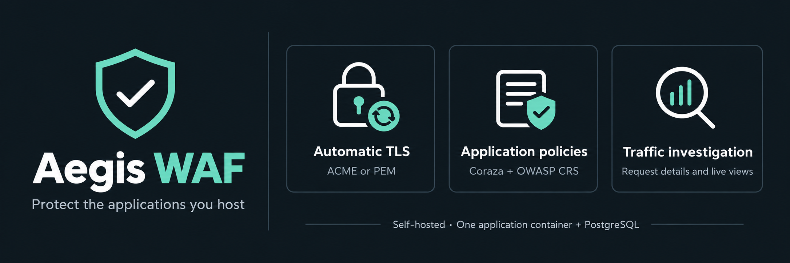
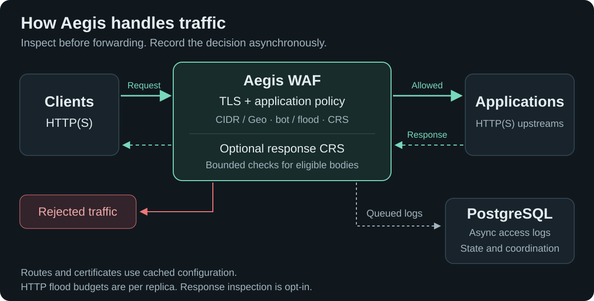

# Aegis WAF

**Protect the applications you host. Manage TLS, application policies and live traffic from one dashboard.**

[](https://github.com/nextgridit-team/Aegis-WAF/actions/workflows/image.yml)
[](LICENSE)

Aegis is a self-hosted web application firewall and reverse proxy for HTTP(S) applications. It combines Coraza and OWASP Core Rule Set (CRS) signatures, automatic certificates and reusable protection policies. Inspection runs inside your deployment: **one application container plus PostgreSQL**, configured through a web interface.

## Why Aegis exists

Offensive tooling is getting faster and more automated, and protection that depends on slow manual log review falls behind. Aegis is a lightweight Go WAF and reverse proxy that added less than a millisecond to mean latency in the published small-request test below.

An optional management MCP endpoint lets your own agents read security telemetry, investigate matched rules, and stage policy changes as disabled drafts; going live requires an explicitly permitted key and a fresh offline impact simulation.



[Get started](#quickstart) · [Documentation](docs/README.md) · [Glossary](docs/glossary.md) · [Security](docs/security.md) · [What changed](CHANGELOG.md) · [Performance](#performance-at-a-glance) · [Report an issue](https://github.com/nextgridit-team/Aegis-WAF/issues)

<a id="deploy-with-docker-compose"></a>

## Quickstart

Use a Linux/amd64 Docker host with **Compose v2+**, **Git** and **Python 3**, and ports 80/443 free for the default mappings.

```sh
git clone https://github.com/nextgridit-team/Aegis-WAF.git
cd Aegis-WAF
python3 scripts/bootstrap-secrets.py
docker compose up -d --wait
```

Compose pulls the public `ghcr.io/nextgridit-team/aegis-waf:latest` image. No source build or registry login is required. The [checked-in compose.yaml](compose.yaml) defines the complete two-container deployment; the bootstrap script creates its secrets once and refuses to overwrite existing material.

Open **http://localhost:9090 on the Docker host**. Read the generated setup code, then create your administrator in the browser:

```sh
cat secrets/bootstrap_secret
```

Choose a unique 14–72-byte password. There are no default credentials; the setup code cannot reset an existing account.

| Listener   | Default host mapping    | Purpose                                        |
| ---------- | ----------------------- | ---------------------------------------------- |
| HTTP       | `0.0.0.0:80 → 8080`     | Application HTTP and HTTP-01 challenges        |
| HTTPS      | `0.0.0.0:443 → 8443`    | Protected applications and TLS termination     |
| Management | `127.0.0.1:9090 → 9090` | Dashboard, management API and health endpoints |

**Installing on a server or through Dockge?** Localhost refers to the Docker host. Follow [remote HTTPS management](docs/deployment.md#remote-https-management) to access the dashboard from another machine. Keep administration separate from public application traffic; remote plain HTTP cannot retain the required Secure session cookie.

For custom ports, native management TLS, backups and multiple replicas, see [deployment](docs/deployment.md).

<a id="what-it-does-today"></a>
<a id="why-aegis"></a>

## What Aegis does

- **Give each application its own protection.** Apply reusable policies with OWASP CRS request signatures, optional response inspection, custom rule groups, synchronized rule feeds and targeted exclusions. Use different policies for internal and external sources.
- **Tune signatures to the application.** Start custom policies in Observe with a 1–5 Sensitivity control. Build reusable curated sets from installed CRS detections, then select them per policy. Published selections stay pinned while you review source updates. [Sensitivity and curated sets](docs/managed-signatures.md#sensitivity-and-curated-sets).
- **Choose targeted mitigation rules.** The [community catalogue](docs/rule-feeds.md) syncs independently versioned CVE rules every 12 hours through a compact release descriptor and package. Enable them inside each policy, select all or individual rules, and explicitly refresh pinned updates. The shipped baseline includes all bundled community mitigations.
- **Manage certificates in the browser.** Request and renew ACME certificates through Cloudflare DNS-01, including wildcards, or HTTP-01. Upload existing PEM certificates and request an early ACME renewal without restarting.
- **See what happened.** Inspect recorded requests and matched rules, follow live traffic maps, and collect structured JSON events or authenticated Prometheus metrics. Configure [alerts](docs/alerts.md) with notification destinations or a signed webhook to your own AI agent. Filter the dashboard by application or view the whole gateway.
- **Control who reaches your applications.** Reuse IP address objects and groups, configure trusted proxies, HSTS and headers, and tune CIDR/Geo decisions and HTTP flood rates. Selective self-hosted image/audio CAPTCHA challenges suspicious traffic and grants bounded clearance after a successful solve.
- **Handle streaming APIs.** Choose Website, API or SSE/streaming per proxy host. API/SSE return JSON denials without browser CAPTCHA. Policies provide API method controls and optional connection, duration and idle limits. Optional response inspection uses bounded overlapping windows for streams; it can stop future output but cannot retract bytes already delivered.
- **Connect your own agent.** An optional management MCP endpoint offers scoped, expiring keys, a downloadable skill and enforced offline simulation before live protection changes. Your agent and model run outside Aegis; no built-in inference is required.
- **Keep your logs where you need them.** Completed requests, security decisions and administrative audits reach Docker stdout as structured JSON. Keep six hours of database history by default, adjust it under **System → Logs & retention**, and use your collector or SIEM for longer retention. [Logging guide](docs/logging.md).
- **Own the deployment.** The app runs as non-root with a read-only root filesystem. Private keys and saved provider credentials are encrypted before storage with an external encryption key. [Security boundaries](docs/security.md).

## Protect your first application

1. **Get a certificate.** In **Certificates**, request one using your domains, email and a scoped Cloudflare API token, or upload a PEM certificate and key. DNS-01 does not require inbound port 80. [Certificate setup](docs/certificates.md).
2. **Connect your application.** Add its exact hostnames, reachable HTTP(S) upstream, endpoint type and certificate in **Applications**. Point client DNS and public traffic at Aegis. Use **Test upstream** to check connectivity before saving; private HTTPS backends support explicit per-host certificate trust. Configure trusted proxies first if another proxy sits in front. [Upstream setup](docs/upstreams.md).
3. **Assign a policy.** Select the included **Baseline protection** policy for CRS protection, or create a custom policy in **Policies** with Standard sensitivity and Observe mode. The baseline uses Block mode, paranoia level 1, threshold 5 and a 1 MiB body limit, with all shipped community mitigations enabled. It takes effect only when assigned; review application compatibility and use Observe while tuning.

Configure community rules under **Policies → Edit → Community mitigations**, with enable/disable and all/individual selection. The baseline selects every bundled community mitigation, including broad endpoint-containment and multipart/Brotli guards. Review coverage and legitimate application operations before assigning it; these partial mitigations do not replace vendor fixes. [Catalogue workflow](docs/rule-feeds.md).

See the [guided setup and investigation workflow](docs/getting-started.md) for signature browsing, exclusions and internal/external assignments. Bot/flood controls and request-content evidence require explicit configuration.

## How it runs



Each replica runs the complete application. PostgreSQL holds authoritative configuration and persistent state; routing and certificate selection use atomically swapped memory snapshots. Local rate budgets are per replica. Optional [Redis/Dragonfly counters](docs/shared-rate-state.md), configured under **System**, share budgets across replicas; the default deployment still needs only Aegis and PostgreSQL. See [architecture and failure behavior](docs/architecture.md) and [inspection limits](docs/body-inspection.md). The graphics illustrate shipped capabilities; [design notes](docs/graphics/README.md) explain their scope.

## Performance at a glance

| Workload                    | Requests/sec | Mean latency | p99 latency |
| --------------------------- | -----------: | -----------: | ----------: |
| Direct upstream             |       15,450 |     1.025 ms |    3.955 ms |
| Aegis, no rules             |       13,029 |     1.218 ms |    4.401 ms |
| Aegis, bundled CRS baseline |       10,808 |     1.471 ms |    3.793 ms |

**Latest lab reference, 2026-10-25:** one verification run on an AMD Ryzen 9 7950X3D, Linux/amd64, Go 1.26.10. Each phase used 64,000 small HTTP/1.1 keep-alive GETs and 16 client threads. These measurements predate all-request stdout export. PostgreSQL access logging and gateway instrumentation were on; evidence capture, response inspection and bot/flood controls were off. CRS used Block mode, PL1 and threshold 5, without exclusions. The CRS mean was approximately 0.45 ms above the direct path; its total mean was 1.47 ms. [Raw report](docs/benchmarks/platform-hardening-20261025.json).

All components shared a Docker host. These short tests are a reference for this workload, not production capacity; TLS handshakes, uploads and adversarial traffic need separate measurements. [Methodology, reproduction and raw reports](docs/benchmarks.md) · [Comparison with other proxies](docs/proxy-comparison.md).

## Screenshots


_Actual application screens with isolated test traffic and example domains. [Screenshot provenance](docs/screenshots/README.md)._


Open **Dashboard → Live traffic map** to follow recorded traffic on the world map and the Aegis-to-application diagram. The dashboard supports light and dark themes. See more screens for [certificates](docs/screenshots/certificates-current.png), [signature sets](docs/screenshots/signature-sets.png), [community rule catalogue](docs/screenshots/rule-catalogue.png), [policies](docs/screenshots/policies.png), [agent access](docs/screenshots/agent-access.png), [System and metrics](docs/screenshots/system.png), and [self-hosted verification](docs/screenshots/bot-challenge.png), and [alerts](docs/screenshots/alerts.png).


Choose the detection rules your application needs, then tune their sensitivity in its policy. [See the policy sensitivity control](docs/screenshots/policy-sensitivity.png) and [the full workflow](docs/managed-signatures.md#sensitivity-and-curated-sets).

<a id="structured-security-logs"></a>
<a id="update-and-recover"></a>

## Documentation

Start with the **[documentation index](docs/README.md)**, or go directly to:

| Task                                       | Guide                                                                                                                                                                                                             |
| ------------------------------------------ | ----------------------------------------------------------------------------------------------------------------------------------------------------------------------------------------------------------------- |
| Deploy, update and recover                 | [Deployment](docs/deployment.md) · [Updates](docs/updating.md) · [Architecture](docs/architecture.md)                                                                                                             |
| Understand certificate and secret storage  | [Certificate lifecycle](docs/certificates.md) · [Encryption at rest](docs/encryption-at-rest.md)                                                                                                                  |
| Apply signatures and tune protection       | [Policies](docs/policies.md) · [Managed signatures](docs/managed-signatures.md) · [Rule catalogues](docs/rule-feeds.md) · [Body inspection](docs/body-inspection.md) · [Security tuning](docs/security-tuning.md) |
| Investigate requests and collect telemetry | [Request details](docs/request-investigation.md) · [JSON security logs](docs/logging.md) · [Prometheus metrics](docs/observability.md) · [Evidence privacy](docs/evidence-privacy.md)                             |
| Scale shared rate budgets                  | [Redis/Dragonfly setup and failure behavior](docs/shared-rate-state.md)                                                                                                                                           |
| Configure country restrictions             | [Geo blocking in a policy](docs/geolocation.md#apply-geo-blocking-to-an-application)                                                                                                                              |
| Connect an external agent                  | [MCP access, permissions and skill](docs/agent-access.md)                                                                                                                                                         |

## Current limits

Aegis is under active development. Body inspection is bounded and response inspection is opt-in. Streaming detections occur after delivery; WebSocket frames, binary gRPC and unsupported types have no body inspection. Bot scoring remains heuristic even with CAPTCHA. Local budgets and connection limits are per replica; shared request-rate counters require optional Redis/Dragonfly. Access logs are asynchronous and best effort; administrative changes use transactional audits. Existing replicas retain loaded configuration during database outages; default cold starts and management authentication need PostgreSQL. Aegis runs no built-in AI traffic analysis. Administrator MFA and online encryption-key rotation remain open. Read the [full limitations](docs/limitations.md) and [security model](docs/security.md) before deployment.

## Support and contributions

Maintained by [nextgridit-team](https://github.com/nextgridit-team). Use [GitHub Issues](https://github.com/nextgridit-team/Aegis-WAF/issues) for bugs and feature requests. Include your image tag/digest, reproduction steps and sanitized logs. Omit passwords, tokens, private keys and captured request secrets. Anyone can [submit a community rule](CONTRIBUTING.md) through a reviewed pull request; include compatibility notes and positive/negative regression cases. For code changes, follow the [development and testing guide](docs/development.md).

## License

Aegis application code is [MIT licensed](LICENSE). Dependencies retain their own licenses; [third-party notices](third_party_licenses/) ship in the image under `/usr/share/licenses/aegis`.
