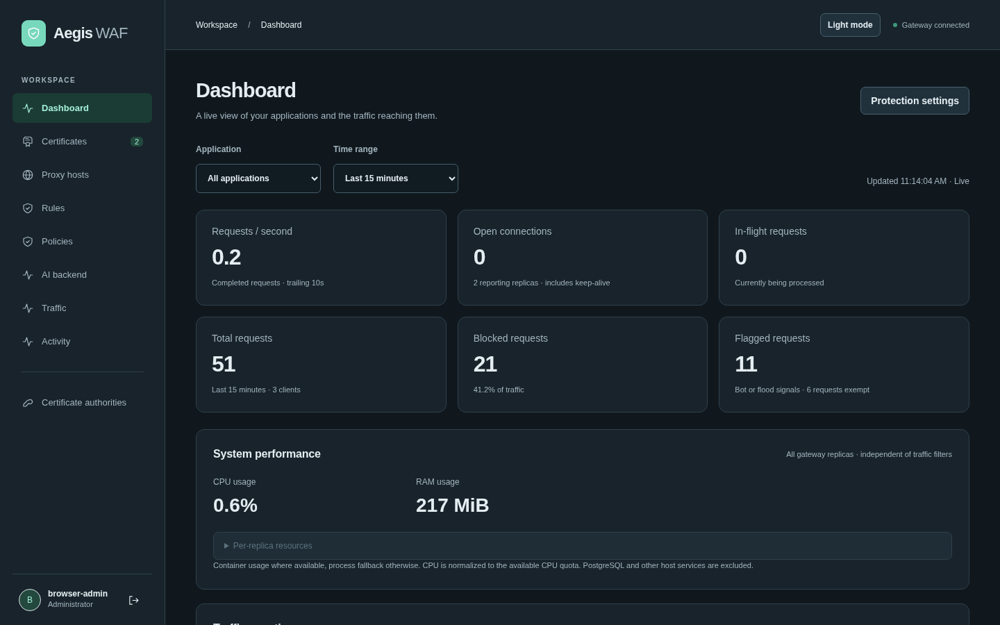
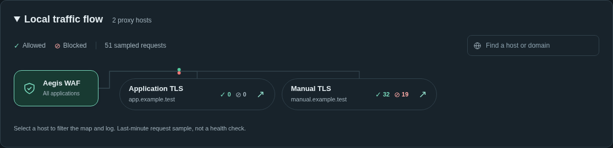

# Aegis WAF

**Protect the applications you host. Manage TLS, application policies and live traffic from one dashboard.**

[](https://github.com/nextgridit-team/Aegis-WAF/actions/workflows/image.yml)
[](LICENSE)

Aegis is a self-hosted web application firewall and reverse proxy for HTTP(S) applications. It combines Coraza and OWASP Core Rule Set (CRS) signatures, automatic certificates and reusable protection policies. Inspection runs inside your deployment: **one application container plus PostgreSQL**, configured through a web interface.



_Real application screens with isolated test traffic and example domains. [Screenshot provenance](docs/screenshots/README.md)._

[Get started](#quickstart) · [Documentation](docs/README.md) · [Security](docs/security.md) · [Performance](#performance-at-a-glance) · [Report an issue](https://github.com/nextgridit-team/Aegis-WAF/issues)

<a id="what-it-does-today"></a>

## Why Aegis

- **Give each application its own protection.** Apply reusable policies with OWASP CRS request signatures, optional response inspection, custom rule groups, synchronized rule feeds and targeted exclusions. Use different policies for internal and external sources.
- **Manage certificates in the browser.** Request and renew ACME certificates through Cloudflare DNS-01, including wildcards, or HTTP-01. Upload existing PEM certificates and request an early ACME renewal without restarting.
- **See what happened.** Inspect any listed request's recorded decision and matched rules. Follow allowed and blocked traffic on the live map and application flow diagram, with global or application filters.
- **Control who reaches your applications.** Reuse IP address objects and groups, configure trusted proxies, HSTS and headers, and tune CIDR/Geo decisions, basic bot signals and HTTP flood rates.
- **Connect your own agent.** An optional management MCP endpoint offers scoped, expiring keys and a downloadable skill. Your agent and model run outside Aegis; no built-in inference is required.
- **Own the deployment.** The app runs as non-root with a read-only root filesystem. Private keys and saved provider credentials are encrypted before storage with an external encryption key. [Security boundaries](docs/security.md).

<a id="deploy-with-docker-compose"></a>

## Quickstart

Use a Linux/amd64 Docker host with **Compose v2+**, **Git** and **Python 3**, and ports 80/443 free for the default mappings.

```sh
git clone https://github.com/nextgridit-team/Aegis-WAF.git
cd Aegis-WAF
python3 scripts/bootstrap-secrets.py
docker compose up -d --wait
```

Compose pulls the public `ghcr.io/nextgridit-team/aegis-waf:latest` image. No source build or registry login is required. The [checked-in compose.yaml](compose.yaml) defines the complete two-container deployment; the bootstrap script creates its secrets once and refuses to overwrite existing material.

Open **http://localhost:9090 on the Docker host**. Read the generated setup code, then create your administrator in the browser:

```sh
cat secrets/bootstrap_secret
```

Choose a unique 14–72-byte password. There are no default credentials; the setup code cannot reset an existing account.

| Listener   | Default host mapping    | Purpose                                        |
| ---------- | ----------------------- | ---------------------------------------------- |
| HTTP       | `0.0.0.0:80 → 8080`     | Application HTTP and HTTP-01 challenges        |
| HTTPS      | `0.0.0.0:443 → 8443`    | Protected applications and TLS termination     |
| Management | `127.0.0.1:9090 → 9090` | Dashboard, management API and health endpoints |

**Installing on a server or through Dockge?** Localhost refers to the Docker host. Follow [remote HTTPS management](docs/deployment.md#remote-https-management) to access the dashboard from another machine. Keep administration separate from public application traffic; remote plain HTTP cannot retain the required Secure session cookie.

For custom ports, native management TLS, backups and multiple replicas, see [deployment](docs/deployment.md).

## Protect your first application

1. **Get a certificate.** In **Certificates**, request one using your domains, email and a scoped Cloudflare API token, or upload a PEM certificate and key. DNS-01 does not require inbound port 80. [Certificate setup](docs/certificates.md).
2. **Connect your application.** Add its exact hostnames, reachable HTTP(S) upstream and certificate in **Proxy hosts**. Point client DNS and public traffic at Aegis. Configure trusted proxies first if another proxy sits in front.
3. **Assign a policy.** Select the included **Baseline protection** policy for CRS protection, or customize one in **Policies**. The baseline uses Block mode, paranoia level 1, threshold 5 and a 1 MiB body limit. It takes effect only when assigned; review application compatibility and use Observe while tuning.

See the [guided setup and investigation workflow](docs/getting-started.md) for signature browsing, exclusions and internal/external assignments. Bot/flood controls and request-content evidence require explicit configuration.

## Performance at a glance

| Workload                    | Requests/sec | Mean latency | p99 latency |
| --------------------------- | -----------: | -----------: | ----------: |
| Direct upstream             |       16,206 |     0.978 ms |    3.431 ms |
| Aegis, no rules             |       13,676 |     1.163 ms |    3.995 ms |
| Aegis, bundled CRS baseline |       10,579 |     1.501 ms |    3.802 ms |

**Lab reference, 2026-10-25:** AMD Ryzen 9 7950X3D, Linux/amd64, Go 1.26.10. Medians of three sequential runs, each with 64,000 small HTTP/1.1 keep-alive GETs per phase and 16 client threads. PostgreSQL access logging was on; evidence capture and bot/flood controls were off. CRS used Block mode, PL1 and threshold 5, without exclusions.

All components shared a Docker host. These short tests are a reference for this workload, not production capacity; TLS handshakes, uploads and adversarial traffic need separate measurements. [Methodology, reproduction and raw reports](docs/benchmarks.md) · [Comparison with other proxies](docs/proxy-comparison.md).

## Screenshots



Open **Dashboard → Live traffic map** to follow recorded traffic on the world map and the Aegis-to-application diagram. The dashboard supports light and dark themes. See more screens for [certificates](docs/screenshots/certificates-current.png), [signature sets](docs/screenshots/signature-sets.png), [policies](docs/screenshots/policies.png) and [agent access](docs/screenshots/agent-access.png).

<a id="how-it-runs"></a>
<a id="structured-security-logs"></a>
<a id="update-and-recover"></a>

## Documentation

Start with the **[documentation index](docs/README.md)**, or go directly to:

| Task                                       | Guide                                                                                                                                   |
| ------------------------------------------ | --------------------------------------------------------------------------------------------------------------------------------------- |
| Deploy, update and recover                 | [Deployment](docs/deployment.md) · [Updates](docs/updating.md) · [Architecture](docs/architecture.md)                                   |
| Understand certificate and secret storage  | [Certificate lifecycle](docs/certificates.md) · [Encryption at rest](docs/encryption-at-rest.md)                                        |
| Apply signatures and tune protection       | [Policies](docs/policies.md) · [Managed signatures](docs/managed-signatures.md) · [Body inspection](docs/body-inspection.md) · [Security tuning](docs/security-tuning.md)            |
| Investigate requests and collect telemetry | [Request details](docs/request-investigation.md) · [JSON security logs](docs/logging.md) · [Evidence privacy](docs/evidence-privacy.md) |
| Connect an external agent                  | [MCP access, permissions and skill](docs/agent-access.md)                                                                               |

## Current limits

Aegis is under active development. Body inspection is bounded; response inspection is opt-in and exempts SSE, upgrades and unsupported content types. Bot detection uses basic signals, and HTTP flood budgets are **per replica**. Logs are asynchronous and best effort. Existing replicas retain loaded configuration during database outages; a default cold start needs PostgreSQL. Aegis runs no built-in AI traffic analysis. Read the [full limitations](docs/limitations.md) and [security model](docs/security.md) before deployment.

## Support and contributions

Maintained by [nextgridit-team](https://github.com/nextgridit-team). Use [GitHub Issues](https://github.com/nextgridit-team/Aegis-WAF/issues) for bugs and feature requests. Include your image tag/digest, reproduction steps and sanitized logs. Omit passwords, tokens, private keys and captured request secrets. For code changes, follow the [development and testing guide](docs/development.md).

## License

Aegis application code is [MIT licensed](LICENSE). Dependencies retain their own licenses; [third-party notices](third_party_licenses/) ship in the image under `/usr/share/licenses/aegis`.
