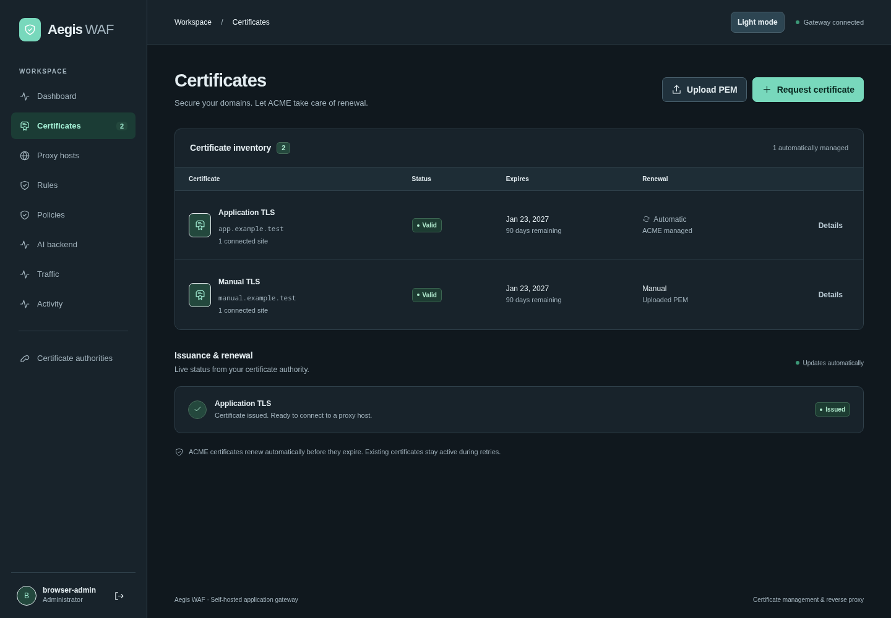
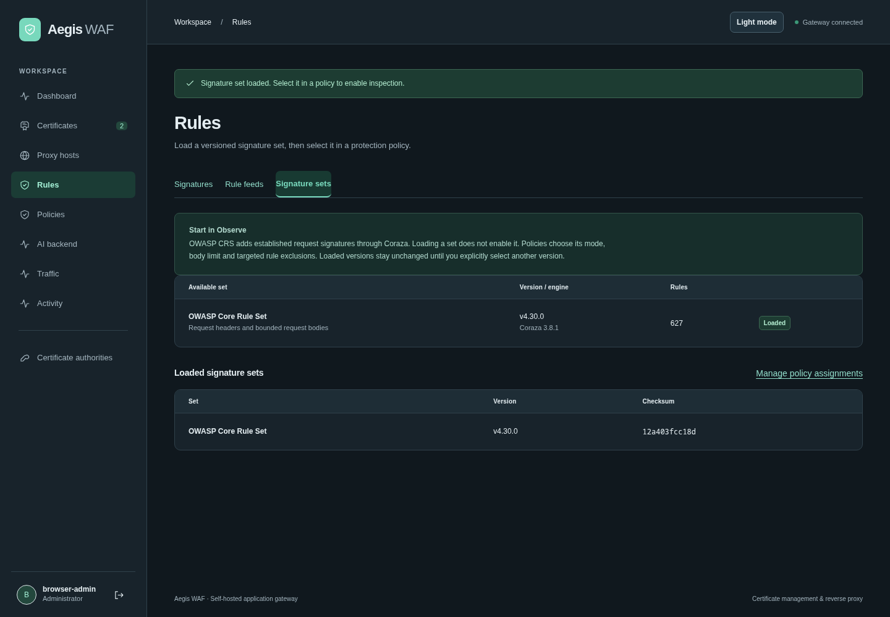
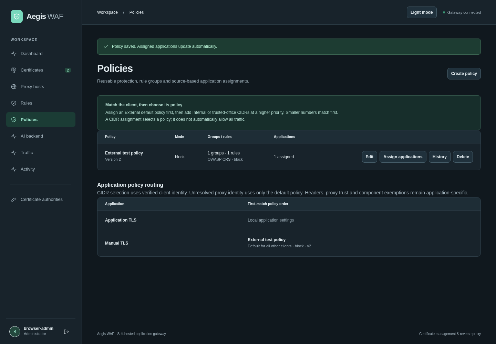
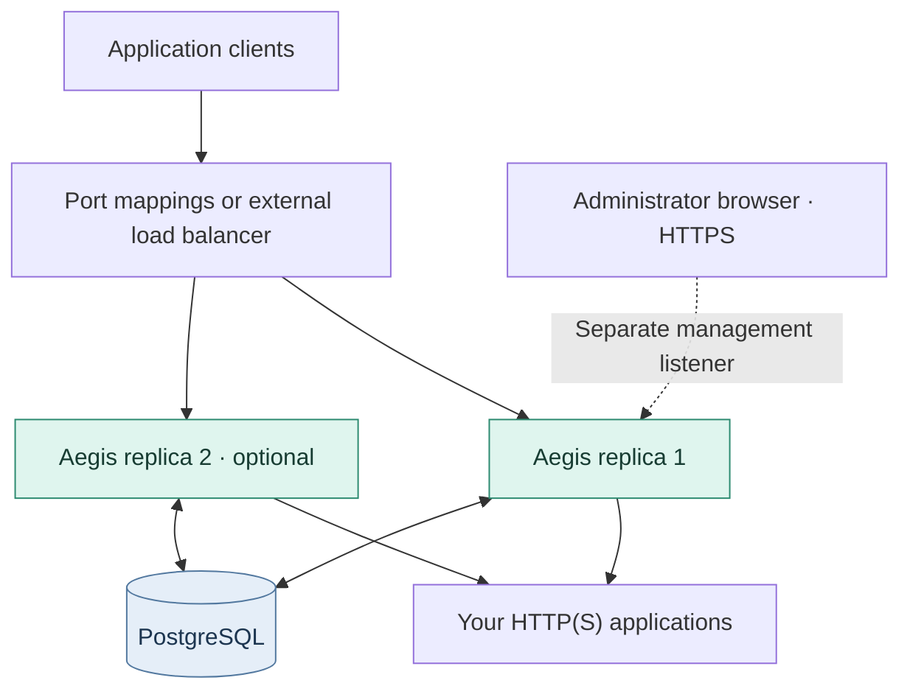

# Aegis WAF

**Self-hosted reverse proxy, TLS certificate management and application protection in one dashboard.**

[](https://github.com/nextgridit-team/Aegis-WAF/actions/workflows/image.yml)
[](LICENSE)

Aegis sits between clients and your HTTP(S) applications. Use its web interface to request certificates, configure upstreams, load OWASP CRS signatures and assign protection policies. It runs as one application container plus PostgreSQL, with a separate management listener and an embedded TypeScript dashboard.

**Under active development.** Request protection is implemented; AI traffic analysis and automatic rule generation are future work. See [current limits](#current-limits) before deploying.

[Deploy](#deploy-with-docker-compose) · [Configure your first application](#protect-your-first-application) · [Screenshots](#screenshots) · [Documentation](#documentation) · [Report an issue](https://github.com/nextgridit-team/Aegis-WAF/issues)


_Actual application screens with isolated test traffic and example domains. Screenshots are illustrative, not performance measurements._

## What it does today

| Area                       | Implemented behavior                                                                                                                                                                                                                                                                            |
| -------------------------- | ----------------------------------------------------------------------------------------------------------------------------------------------------------------------------------------------------------------------------------------------------------------------------------------------- |
| **Certificates**           | Guided ACME issuance and renewal; Cloudflare DNS-01, including wildcards; HTTP-01; staging, production and custom ACME directories; PEM upload and replacement.                                                                                                                                 |
| **Reverse proxy**          | Exact-host routing to HTTP(S) upstreams, TLS termination, optional HTTPS redirects, WebSockets and streaming, verified upstream TLS, and configurable request/response headers.                                                                                                                 |
| **Managed signatures**     | Coraza with bundled OWASP CRS v4.30.0. Explicitly load a version and select it in a policy. Observe/Block modes, anomaly threshold, paranoia level, body limits and rule-ID exclusions.                                                                                                         |
| **Policies**               | Reusable bot/flood controls and custom rule groups assigned to applications. Ordered source-IP/CIDR assignments support different internal and external policies.                                                                                                                               |
| **Custom rules and feeds** | Visual condition editor, JSON import/export, standalone rule activation/expiry, history, rollback and replay against retained facts. Public HTTPS JSON feeds sync every 12 hours or on demand and stage candidates for review.                                                                  |
| **Bot and flood controls** | Basic scanner/headless User-Agent signals and configurable per-client/application rate limits. Independent bot/flood CIDR exemptions. Limits are per replica.                                                                                                                                   |
| **Visibility**             | Global/application traffic, requests per second, connections, status codes, blocking statistics, optional local country lookup, replica CPU/RAM, access logs and administrative audit events. Click any listed request for its recorded decision, rule/signature details and retained evidence. |
| **Evidence**               | Opt-in sampled, bounded request facts with allowlists, redaction and expiry. Custom-rule replay does not send requests upstream.                                                                                                                                                                |
| **AI connection setup**    | OpenAI-compatible endpoint, optional encrypted API key, model-list discovery and model selection. No inference or traffic submission.                                                                                                                                                           |

Sites, certificates, policies and application settings are managed through the dashboard or management API. Site changes do not require configuration-file edits or image rebuilds.

## Deploy with Docker Compose

You need **Docker Engine with Compose v2+**, **Git** and **Python 3**. The published image currently targets **Linux/amd64**. Ports 80 and 443 must be available on the Docker host for the default mappings.

```sh
git clone https://github.com/nextgridit-team/Aegis-WAF.git
cd Aegis-WAF
python3 scripts/bootstrap-secrets.py
docker compose up -d --wait
```

The script creates deployment secrets once and refuses to overwrite a nonempty `secrets/` directory. Compose pulls the public image `ghcr.io/nextgridit-team/aegis-waf:latest`; no Go/Node build or registry login is required.

Open **http://localhost:9090 on the Docker host**. Read the generated setup code locally:

```sh
cat secrets/bootstrap_secret
```

Complete setup in the browser with that code, your chosen administrator name and a unique 14–72-byte password. Then sign in. There are no default credentials, and the bootstrap code cannot reset an existing account.

| Listener     | Default host mapping    | Purpose                                            |
| ------------ | ----------------------- | -------------------------------------------------- |
| Public HTTP  | `0.0.0.0:80 → 8080`     | Application HTTP, redirects and HTTP-01 challenges |
| Public HTTPS | `0.0.0.0:443 → 8443`    | TLS termination and protected applications         |
| Management   | `127.0.0.1:9090 → 9090` | Dashboard, management API, `/livez` and `/readyz`  |

**Deploying on a server or through Dockge?** Localhost means the Docker host, not your laptop. Keep management separate and use HTTPS for remote browser access. Aegis supports an existing HTTPS management proxy or native management TLS after a matching certificate is stored. Follow [remote HTTPS management](docs/deployment.md#remote-https-management) before publishing port 9090 to your LAN. Plain HTTP on a remote IP cannot retain the required Secure session cookie.

For custom port mappings, source builds, secret inputs, backups and multiple replicas, see the [deployment guide](docs/deployment.md).

## Protect your first application

1. **Get a certificate.** Open **Certificates → Request certificate**. For Cloudflare DNS-01, enter domains, email and an API token scoped to the zone with **Zone Read** and **DNS Edit**, then explicitly accept the CA terms. Aegis handles account registration, validation, issuance and renewal. DNS-01 needs no inbound port 80. [Cloudflare setup](docs/cloudflare.md) covers permissions and prerequisites. Use **Advanced options** for staging/custom CAs or HTTP-01, or **Upload PEM** for an existing certificate and key.
2. **Connect the upstream.** When issuance succeeds, choose **Connect site**, enter the application's reachable HTTP(S) upstream URL and save. In **Proxy hosts**, set its exact hostnames, certificate, redirect and header options. Point client DNS and your port mappings/load balancer at Aegis. The upstream's `localhost` would mean the Aegis container itself.
3. **Choose baseline protection.** New installations and upgrades include an editable **Baseline protection** policy with CRS already loaded: Block mode, paranoia level 1, anomaly threshold 5 and a 1 MiB request-body limit. Select it under **Initial protection policy** while adding a proxy host, or assign it from Policies. Bot/flood controls remain off until tuned. Existing applications are not assigned automatically.
4. **Inspect or customize signatures.** In **Rules → Signature sets**, choose **View signatures** for searchable rule IDs, descriptions and metadata. **Apply to policy** configures a new or existing policy with the set selected. In **Policies**, use **Browse signatures and exclusions** for targeted exceptions. Start custom policies in **Observe**, then assign applications. Add custom rule groups and bot/flood settings as needed. Assign a default policy before adding higher-priority CIDR policies. If Aegis is behind a proxy, configure its trusted addresses and client-IP header first.
5. **Review, then enforce.** Check the Dashboard and Activity for matches. Tune exclusions, body limits and rates, then explicitly choose **Block**. Policy Observe caps managed signatures at Observe; Off disables them. Policy assignments replace that application's standalone rule activation and local bot/flood settings.

Replicas check configuration versions every **2 seconds**; compilation/loading can add time for new managed signature configurations. Local bot/flood controls are Off and evidence capture is disabled. The included baseline enforces CRS only after you explicitly assign it. Deleting or editing that baseline is preserved across restarts; upgrades do not overwrite it. A wildcard certificate covers TLS names; proxy routes still require exact configured hostnames.

## Screenshots

### Certificates and automatic renewal



### Load a versioned signature set



### Assign protection to applications



The dashboard supports light/dark themes and mobile layouts. See [screenshot provenance and regeneration](docs/screenshots/README.md) for the test fixture used to capture these images.

## How it runs



Each replica contains the proxy, dashboard/API, configuration refresher, logging and coordinated certificate/feed workers. PostgreSQL is authoritative for configuration, encrypted key material, sessions, jobs, logs and coordination. Routing, certificate selection and rule evaluation use cached snapshots rather than a database query for every request.

The application runs as a non-root UID with unprivileged internal ports. Compose uses a read-only application root, an explicit temporary directory, dropped capabilities and no Docker socket. The default deployment needs only PostgreSQL's persistent volume. An [optional encrypted recovery cache](docs/snapshot-cache.md) adds local snapshot storage when explicitly enabled.

## Current limits

- **Flood budgets are replica-local.** More replicas increase the effective aggregate allowance; budgets reset on process restart. Cluster-wide rate coordination is not implemented.
- **CRS inspects requests only.** Response-body inspection is disabled. In Block mode, requests over the policy body limit are rejected with 413; Observe forwards them with incomplete-inspection metadata. New custom policies default to 64 KiB; the included baseline uses 1 MiB. Configurable range: 4 KiB–1 MiB. Review upload-heavy applications before enforcing. [Managed signature behavior](docs/managed-signatures.md).
- **Bot detection is basic and spoofable.** There is no CAPTCHA, browser challenge, verified-bot identity, behavioral learning or network-layer DDoS protection.
- **AI setup is configuration only.** No background traffic review, generated signatures, automated policy changes or cross-signal weighted scoring is active. CRS's own inbound anomaly scoring is implemented separately.
- **Database outages have defined limits.** Running replicas retain their last loaded routes, certificates and policies; sign-in, administrative changes and HTTP-01 lookup still require PostgreSQL. A default replica starting during an outage remains unready. [Failure and recovery behavior](docs/deployment.md#health-and-database-outages).
- **Logs are best effort.** Forwarding/enforcement precede queued log writes. Queue saturation, outages or process crashes can lose records. Access/audit retention is manual; sampled evidence has its own automatic expiry. [Logging](docs/logging.md) · [Privacy](docs/evidence-privacy.md).
- **Encryption covers secret values.** Private keys and saved credentials use AES-256-GCM with an external key. Public certificate chains, configuration and logs are not encrypted by that application layer. Online key rotation, MFA, password recovery and granular administrator roles are not implemented. [Encryption details](docs/encryption-at-rest.md).

See [measured performance and comparison limits](docs/proxy-comparison.md). Those small-workload results do not establish production capacity or security parity with other WAFs.

## Update and recover

Back up PostgreSQL and retain the external encryption key before updating. From your deployment directory:

```sh
docker compose pull app
docker compose up -d --no-deps --wait app
```

Use the same Compose overlays and environment overrides you used for deployment. In Dockge, use its update/pull-and-recreate action. CI publishes on main pushes, nightly at **07:17 UTC**, and on manual runs; publishing does not restart your installation.

For reproducible deployment or rollback, pin `AEGIS_IMAGE` to a unique build tag or digest. Preserve the database and secret files, and check schema/feature compatibility before downgrading. See [image publishing](docs/image-builds.md) and [backups](docs/deployment.md#backups-and-recovery). Loaded CRS sets stay pinned until you explicitly select a different stored version.

## Documentation

| Task                                                                    | Guide                                                                                                                                                      |
| ----------------------------------------------------------------------- | ---------------------------------------------------------------------------------------------------------------------------------------------------------- |
| Deploy, configure listeners, enable HTTPS management, scale and recover | [Deployment](docs/deployment.md)                                                                                                                           |
| Request certificates through Cloudflare                                 | [Cloudflare DNS-01](docs/cloudflare.md)                                                                                                                    |
| Set up policies, groups and internal/external assignments               | [Policies](docs/policies.md) · [Managed signatures](docs/managed-signatures.md)                                                                            |
| Create rules, consume feeds and replay retained facts                   | [Custom rules](docs/rules.md) · [Rule feeds](docs/rule-feeds.md)                                                                                           |
| Configure forwarded identity, headers and exemptions                    | [Headers and CIDRs](docs/headers-and-cidrs.md)                                                                                                             |
| Understand metrics, logs and evidence storage                           | [Dashboard](docs/dashboard.md) · [Request investigation](docs/request-investigation.md) · [Logging](docs/logging.md) · [Privacy](docs/evidence-privacy.md) |
| Configure an AI endpoint or read the proposed AI workflow               | [Provider setup](docs/ai-provider.md) · [Build-sheet review](docs/ai-use-cases-review.md)                                                                  |
| Automate or develop                                                     | [Management API](docs/management-api.md) · [Development and tests](docs/development.md)                                                                    |

## Support and contributions

Maintained by [nextgridit-team](https://github.com/nextgridit-team). Use [GitHub Issues](https://github.com/nextgridit-team/Aegis-WAF/issues) for bugs and feature requests. Include the image tag/digest, reproduction steps and sanitized logs; omit passwords, API tokens, private keys and captured request secrets. For code changes, explain the behavior and run the relevant checks in the [development guide](docs/development.md).

## License

Aegis application code is [MIT licensed](LICENSE). Distributed dependencies retain their own licenses; their [notices](third_party_licenses/) are included in the image under `/usr/share/licenses/aegis`.
