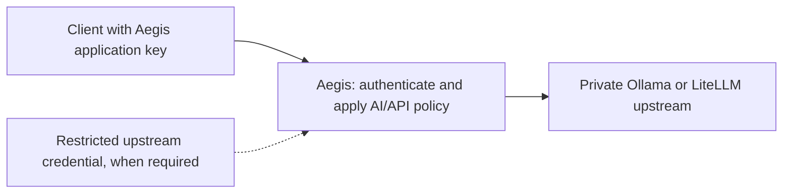

# Proposal: AI endpoint and external MCP protection

**Status: proposed, not implemented.** This is a product direction for discussion, not a configuration guide. The existing [management MCP endpoint](agent-access.md) lets an agent administer Aegis; it does not implement the external-server protection described here.

## Product boundary

Add optional AI/API protection profiles to Aegis proxy hosts. Reuse TLS, routing, address objects, policies, secret encryption and investigation views. Keep the default website workflow simple. Do not introduce a second product, inference engine, billing system or provider router for the first milestone.

The intended upstreams include **Ollama** and the **LiteLLM gateway** (not the LightLLM inference server). LiteLLM already offers virtual keys, model restrictions and budget/rate controls. Keep provider routing and cost accounting there, and configure Aegis with a narrowly scoped LiteLLM virtual key rather than its master key. Review the selected LiteLLM version, licensing and permission inheritance when provisioning it. [LiteLLM virtual-key documentation](https://docs.litellm.ai/docs/proxy/virtual_keys).

Ollama's local API does not require authentication, so an upstream key must be optional. Backend network access must be restricted to prevent callers bypassing Aegis. [Ollama authentication](https://docs.ollama.com/api/authentication).

## First milestone: authenticate inference clients safely

The dashboard would collect the hostname, upstream URL, protocol profile, optional upstream credential and policy. Administrators would create independently revocable client keys scoped to applications and allowed API capabilities. These keys must be separate from administrator sessions and Aegis management MCP keys.

| Concern           | Proposed behavior                                                                                                                                                                                                                |
| ----------------- | -------------------------------------------------------------------------------------------------------------------------------------------------------------------------------------------------------------------------------- |
| Client keys       | Generate strong random keys, show once, store hashes; support names, expiry, revocation and source IP objects/groups.                                                                                                            |
| Upstream secrets  | Encrypt using the existing external-key pattern. Strip caller authentication and spoofable identity headers before adding the approved upstream credential. Exclude credentials from logs and errors.                            |
| API exposure      | Explicitly allow supported inference routes and model IDs. Deny model administration, model pull/delete, key management and gateway configuration routes by default. Filter discovery responses consistently with authorization. |
| Resource controls | Bound request bytes, concurrency and timeouts; validate supported model/output-limit parameters. Preserve SSE streaming, backpressure and cancellation without buffering entire responses.                                       |
| Rule selection    | Use an AI/API policy profile. Code-generation prompts legitimately contain SQL and HTML, so generic website signatures need testing and targeted exclusions.                                                                     |
| Investigation     | Record application, client-key identifier, model, status, duration and available usage metadata. Keep raw prompts and completions out of logs by default.                                                                        |

Start with a documented subset of OpenAI-compatible inference routes and test it against both upstreams. Native Ollama routes can be added explicitly; do not promise that every route or provider-specific extension works through a generic profile.

A single restricted upstream key separates external clients from the upstream credential but aggregates their upstream identity and budget. If distinct LiteLLM budgets or attribution are required, use explicit per-client upstream credential mappings or another documented identity integration. Aegis request limits cannot substitute for accurate token/cost accounting.

Avoid model calls on the forwarding path. Cache authorization only with a documented revocation interval and failure behavior. Existing flood controls are per replica; strict global quotas or concurrency limits need additional coordination and tests before being promised.

### Acceptance criteria before release

- Missing, expired, revoked or incorrectly scoped keys cannot forward; management MCP keys cannot authenticate inference requests.
- Clients cannot reach upstream administration through path normalization, redirects, alternate headers or supported-route ambiguities. Upstream credentials never reach client responses or normal logs.
- Streaming starts promptly, stays bounded under slow readers and propagates disconnects to release upstream work.
- Concurrent replicas enforce the documented authorization refresh and limit semantics during database failures and restarts.
- Ordinary coding prompts remain usable under the selected policy, with explicit tests for malformed/oversize requests and header spoofing.

## Later milestone: protect external MCP servers

External MCP protection needs its own protocol-aware profile. The management MCP implementation does not automatically provide this capability.

The profile should authorize each supported request and tool invocation, validate bounded JSON-RPC structures and enforce method/tool/argument permissions. Hiding a tool from discovery is insufficient if a caller can still invoke it directly. Long-lived streams and state handles need bounds and identity binding appropriate to the supported protocol version.

Authentication requires a deliberate resource and identity model. MCP forbids accepting a token intended for another resource and simply passing it downstream. An Aegis-terminating gateway needs audience validation and a separate upstream credential or supported delegated authorization flow, plus correct discovery and consent behavior. Shared upstream service credentials do not preserve per-user permissions automatically. [MCP security guidance](https://modelcontextprotocol.io/specification/latest/basic/security_best_practices).

Pin and test a supported MCP protocol version and transport; do not assume every client implements the same session or OAuth behavior. Validate Origin where applicable and constrain discovery/redirect destinations to prevent credential leakage and SSRF.

## Security claims to avoid

Request structure, authorization and resource limits are useful protections. They do not prove that a prompt is safe, that a tool's result is trustworthy, or that an allowed tool cannot have harmful side effects. Do not advertise comprehensive prompt-injection or tool-poisoning prevention from signature matching. Optional asynchronous investigation can be evaluated later without adding inference latency to every request.
