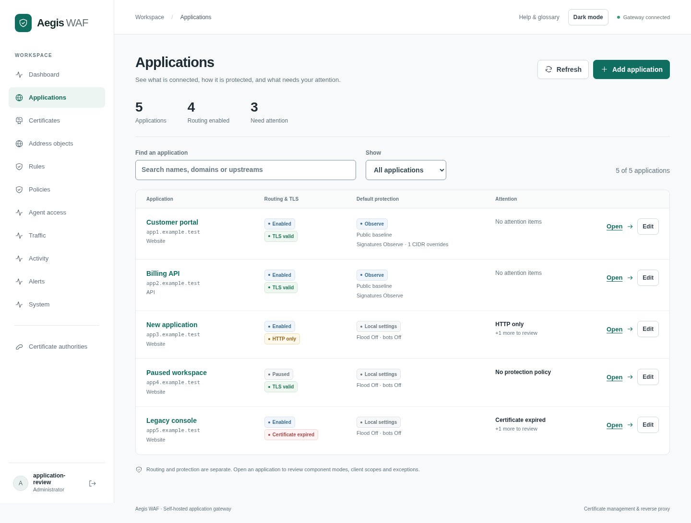

# Manage an application

Open **Applications** to see routing, TLS and default protection together. This replaces the former Proxy hosts inventory; existing `#proxy-hosts` and `#sites` bookmarks still open Applications. The underlying proxy-host API and configuration are unchanged.

Search by application name, domain or upstream. Use **Needs attention** to find missing policies, missing or expired certificates, certificates expiring within 14 days, disabled default policies and policies without active components. **Routing paused** filters disabled applications. These are configuration checks, not a public reachability or security assessment. Policy-loading failures are shown as unavailable.

[Application detail](screenshots/application-detail.png) · [Dark theme](screenshots/application-dark.png) · [Screenshot provenance](screenshots/README.md)

## Connect and verify

The empty inventory links to certificate issuance and PEM upload. **Add application** opens the existing configuration form, including **Test upstream** and the initial protection policy selector. Review the selected policy's mode before saving: the included baseline uses Block, while new custom policies start in Observe. Certificate issuance also retains **Connect site**, which fills in the issued certificate and domains.

After saving, open the application by name or choose **Open**. Review its public domains, upstream, certificate, client-IP source and component exemptions. Configure client DNS and listener ports, send a request, then choose **Refresh** to inspect recorded traffic. An empty request window does not establish whether the application is reachable.

## Understand protection

**Protection by client scope** lists CIDR overrides in priority order and the default for all other clients. It shows effective modes for request signatures, response inspection, flood controls, bots, community mitigations, custom groups, CIDR/Geo blocking and connection limits. Policy Off disables components; Observe caps their blocking modes. The view also exposes signature exception counts, allow-range bypass scope and the number of applications sharing each policy.

Routing Enabled describes saved routing configuration. Paused applications retain their settings but do not accept routed traffic. The protection summaries describe saved policy configuration, not a per-replica loading acknowledgement or a guarantee every request receives every check. Body limits, rule conditions, exemptions and client identity still affect evaluation. Applications without policies show local bot/flood settings and link to standalone rules separately.

The page loads a snapshot when opened or refreshed; it does not replace fields in the background. **Open traffic dashboard** carries the application filter into the live dashboard. Browser Back returns to the application.

## Investigate and tune

**Recent traffic** shows this application's last 15 minutes and latest 20 recorded requests. Counts come from the existing dashboard API and retain its dropped-log warning. Upstream HTTP errors remain distinct from WAF blocks. A traffic-loading failure leaves saved settings visible and offers Retry.

Choose **View details** to inspect the recorded decision and policy revision. **Review current policy** opens the current policy, which may differ from the recorded version. Eligible managed detection rules offer **Draft exception**. This opens an unsaved scoped exception for that rule; no setting is changed until **Save policy**. Select a path prefix, parameter or verified client range and review every application sharing the policy before saving. The form preserves other current policy settings and uses the existing revision check to reject stale writes.

Scoring/control rules cannot use this shortcut. A changed signature set, removed policy or full exception list requires reviewing the current configuration. Missing request content is never reconstructed or automatically captured. See [request investigation](request-investigation.md) and [policy tuning](policies.md).
