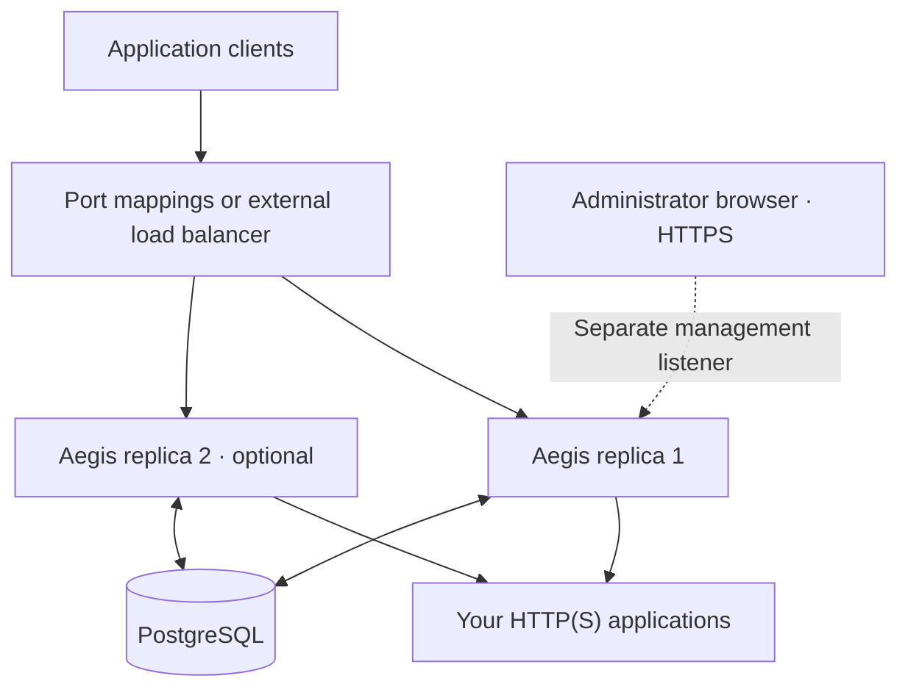

# Application architecture

Each replica runs the complete Go application: reverse proxy, management API/dashboard, configuration and certificate refresh, asynchronous logging, and coordinated background jobs. Production TypeScript assets are embedded in the Go application. The default Compose deployment adds only PostgreSQL.

## State and the request path

PostgreSQL is authoritative for applications/hostnames/upstreams, certificates and encrypted keys, ACME state, administrator sessions, policies, logs and coordination. Deployment supplies database access, the external encryption key, listeners and the bootstrap secret. Application settings are changed through the dashboard/API.

Replicas cache active routes, policies and certificates in memory and poll configuration versions every two seconds by default. Compilation/loading can add propagation time. Routing and TLS selection do not query PostgreSQL for each decision. The request path resolves client identity, chooses cached protection, applies its decision, then attempts a nonblocking enqueue for logging.

A runtime database failure leaves existing replicas with their last loaded routes and valid certificates. Administrative/session operations still depend on PostgreSQL. A default cold start requires the database; optional [sealed snapshots](snapshot-cache.md) support explicitly configured recovery. Certificate expiration is still enforced.

## Coordination and scale

Replicas share ACME accounts, challenges and job state. Database locks coordinate issuance and renewal; sessions work across replicas without sticky routing. Every replica uses the same database and external encryption key. No Redis, separate worker image or Kubernetes component is required.

An external load balancer can distribute public traffic. Fixed Compose host-port mappings must be adjusted before scaling multiple replicas on one host. Default local HTTP flood budgets are per replica; optional Redis/Dragonfly counters coordinate flood and bot-frequency budgets across replicas. PostgreSQL remains authoritative for all configuration/rule state. See [deployment and pooling constraints](deployment.md#multiple-replicas).

## Security and operations

The management listener is separate from protected listeners. The app container uses unprivileged internal ports, a read-only root and an explicit temporary directory. PostgreSQL owns default persistent application state; no persistent local app volume is needed unless optional snapshot recovery is enabled.

See [security boundaries](security.md), [certificate storage](certificates.md), [logging and worker recovery](logging.md) and [deployment](deployment.md). [Dashboard design notes](design.md) explain interface decisions separately from this runtime architecture.

## Atomic reload and active connections

Refresh reads a consistent PostgreSQL snapshot, loads/decrypts certificates, validates routes and compiles protection engines before calling `atomic.Pointer[snapshot].Swap`. A failed load/compile retains the complete prior snapshot. Request routing loads one snapshot and keeps its selected policy/engine for that request; a stream or upgraded connection can continue against that admitted configuration while new requests use the next snapshot. This intentionally does not revoke existing sessions or re-evaluate an open connection after every policy edit.

Old upstream transports close idle pooled connections only; active forwarding connections are not closed by configuration refresh. In-flight requests retain their admitted objects, so frequent reloads with long-lived streams can keep multiple configuration generations resident. Existing TLS sessions retain the certificate negotiated at handshake, and new handshakes use the new cached certificate. No application restart or listener replacement is involved. Propagation across replicas normally takes the two-second polling interval plus load/compile time, not an instantaneous cluster-wide transaction. Application configuration remains dashboard/API/database managed; there is no site-file watcher.

Regression tests hold real HTTP/1.1 and HTTP/2 SSE streams and a bidirectional upgraded connection open during rule/CIDR/certificate changes, verify new-request enforcement and fresh TLS selection, then continue the original streams. They also verify failed candidate compilation preserves the active pointer. This is transport continuity coverage, not a guarantee against unrelated network failure or a full gRPC interoperability/body-inspection test.
