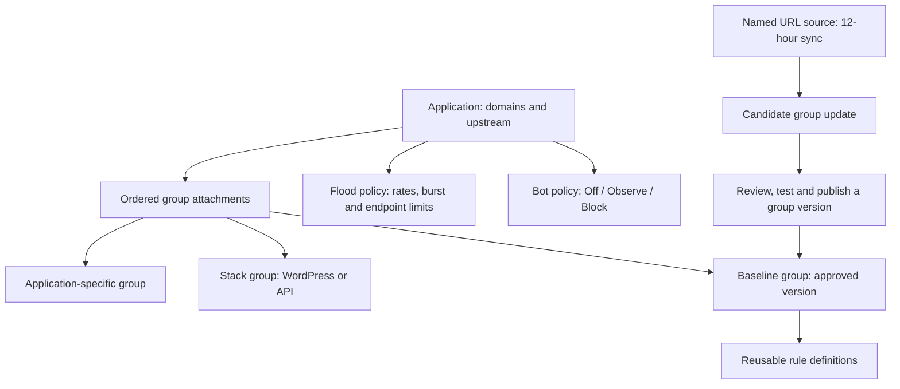

# Application protection mapping: Cloudflare research notes

Reviewed 2026-10-24 against Cloudflare's official product documentation. This is historical research and design context, not the current feature reference. Aegis now ships reusable policies, frozen rule groups, managed signatures, selective CAPTCHA and optional shared counters; see [policies](policies.md), [bot verification](bot-protection.md) and [rate state](shared-rate-state.md). Cloudflare-specific features and plan availability are not Aegis capabilities.

## What Cloudflare does

Cloudflare uses reusable, ordered, versioned rulesets and separately deploys them into request-processing phases. A ruleset is not just a label: deployment decides where it runs. This is the useful pattern for application-to-group mapping. [Rulesets](https://developers.cloudflare.com/ruleset-engine/about/rulesets/)

Managed rules can be overridden at ruleset, tag/category and individual-rule levels. More specific overrides take precedence; exceptions can skip selected rules under matching conditions. This supports application-specific tuning without changing a shared rule library. [Overrides](https://developers.cloudflare.com/ruleset-engine/managed-rulesets/override-managed-ruleset/), [Managed Rules](https://developers.cloudflare.com/waf/managed-rules/)

Rate limiting separates the request-matching expression, counter characteristics, counting expression, requests per period, and mitigation duration/behavior. Matching a login route and counting failed login responses are distinct decisions. Feature availability varies by plan. This is a useful model for targeted application/endpoint limits rather than one universal requests-per-second number. [Parameters](https://developers.cloudflare.com/waf/rate-limiting-rules/parameters/)

Cloudflare bot controls combine settings with custom rules that can use bot-detection fields, verified-bot identity and route scope. Its bot intelligence is separate from the action applied to a match. Copying the settings UI would not provide that detection capability. [Bot rules](https://developers.cloudflare.com/bots/additional-configurations/custom-rules/)

Cloudflare defines processing order and terminating actions: custom rules, rate limiting, managed WAF rules and bot settings run in defined stages. A terminating block prevents later stages from evaluating. Exceptions therefore require explicit scope and ordering. [Interoperability](https://developers.cloudflare.com/waf/feature-interoperability/)

## Original design proposal

This is a design recommendation derived from the research and the user's application-first requirements, not a claim that Cloudflare's internal implementation is known.

A **rule** defines a bounded match and default action, stable ID, explanation, tags and false-positive notes. A **group** owns an ordered collection of those rules, a description, applicable technology/surface and version history. An **application attachment** chooses a group/version, mode, priority and additional scope such as path prefixes and methods. Rules in an attached group run only when both attachment scope and rule conditions match. One group can protect several applications with different modes and exceptions.

The application UI should contain Routing, TLS and Protection. Protection contains Anti-bot, HTTP flood, applied groups and scoped exceptions. The global Rules/Groups library manages reusable definitions. Application users should see the effective rules and why each applies without navigating several unrelated pages.

Group attachments need Off, Observe and Enforce. A deployment summary should show application, selected group version, inherited defaults, local overrides and pending changes. Published versions should be pinned on applications until an explicit update is applied. A feed sync must never silently replace an enforced version. Source -> candidates -> group draft -> published version -> application attachment makes that boundary visible and supports rollback.

An exception must identify the target group/rule or protection component plus a narrow condition. Avoid a global 'allow this request forever' shortcut that bypasses all later checks. For example, exclude a signed webhook endpoint from a particular bot signal while retaining request-size and flood controls. Application overrides take precedence over group defaults; individual-rule overrides take precedence over group/category overrides. Persist, audit and show the effective result.

## Helping users choose groups

Offer suggested groups based on an explicitly chosen application type, with a clear description of coverage and compatibility. Suggestions should explain why they apply and start in Observe. Technology selection is administrator input, not an invented traffic-learning result.

| Group                            | Intended surface                                 | Initial recommendation                                                   |
| -------------------------------- | ------------------------------------------------ | ------------------------------------------------------------------------ |
| Baseline exposed-resource probes | Sensitive configuration and source-control paths | Review applicability; observe before enforcement                         |
| Scanner signals                  | Declared scanner user agents                     | Observe; agents can be spoofed and legitimate tools can match            |
| WordPress                        | Selected WordPress paths/methods                 | Implement tested stack-specific signatures before advertising coverage   |
| API                              | Selected API routes and methods                  | Scope policies to real API behavior; do not require browser-only signals |
| Authentication abuse             | Actual login/reset endpoints                     | Separate endpoint limits from whole-application flood budgets            |
| Application-specific             | Administrator-selected paths and inputs          | Keep exceptions and custom rules local to the application                |

SQL injection, XSS and other broad exploit categories need a validated rule corpus or an established compatible engine. The current starter feed is not such a corpus. Do not present a few generic regexes as comprehensive protection. Cloudflare managed signatures are not an exportable Aegis feed; compatibility requires an intentional adapter and an appropriate source/license.

Every detection event should identify application, component, group/version, rule ID, matched condition and action. Dashboard filters should follow that same hierarchy. Rule recommendations should be supported by tests/coverage notes, not just an opaque 'recommended' badge.

## Implementation status and next increment

Current implementation: application routing/TLS, basic bot modes, configurable per-client and whole-application rate/burst budgets, trusted proxy identity, application/global telemetry, individual site-scoped JSON rules, named URL candidate subscriptions, and explicit draft import. Application create/edit saves routing and bot/flood settings atomically. Current bot signals are user-agent signatures, and current flood counters are per replica; neither is equivalent to Cloudflare's distributed detection/mitigation platform.

Next structural increment: implement reusable rule/group storage, versioned membership and application attachments, then migrate existing site-scoped rules into an application-local group without changing effective enforcement. Feed review/import can then target a group draft rather than immediately producing site-scoped copies. Add app type/coverage guidance and group/rule-level event attribution together. Keep current rule activation, expiry and rollback behavior until migration semantics are explicitly implemented and tested.

After that, add targeted endpoint rate policies (path/method, counting key, period, burst and mitigation duration), narrow exceptions, preview/effective-policy views, group-version publishing and rollback. Keep default thresholds illustrative and configurable; application capacity and legitimate burst patterns differ.

## Implemented foundation update

The policy page now publishes frozen signature groups, shared bot/flood settings, and application assignments, including ordered source-CIDR policy selection with a mandatory default. Rules and Rule feeds share one workspace. See [current policy behavior and limits](policies.md). Endpoint counting rules, coverage recommendations and score-based decisions remain future work; the earlier recommendations above are design context.
