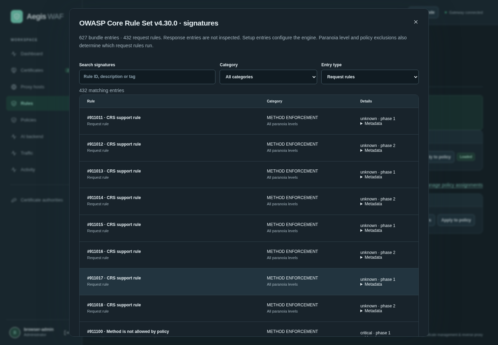
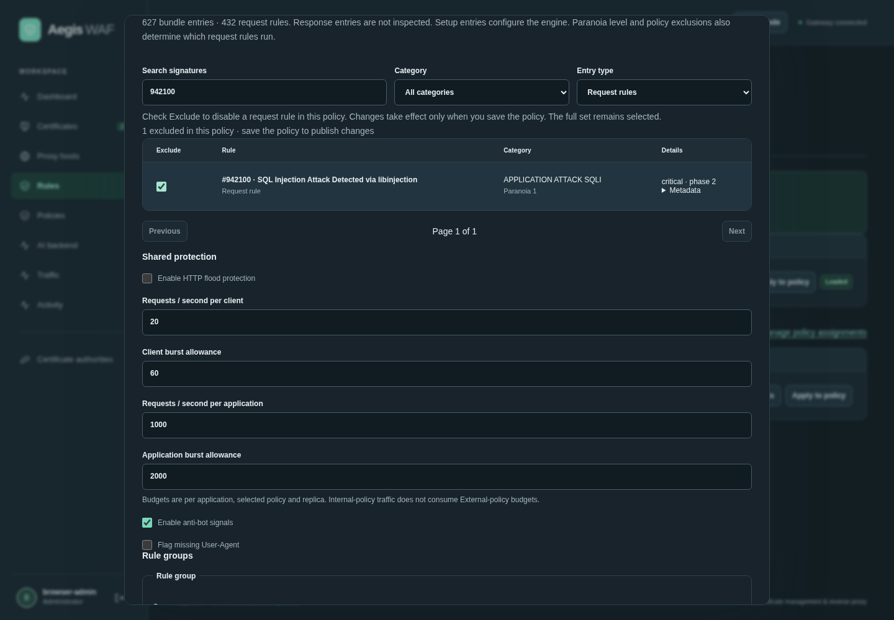
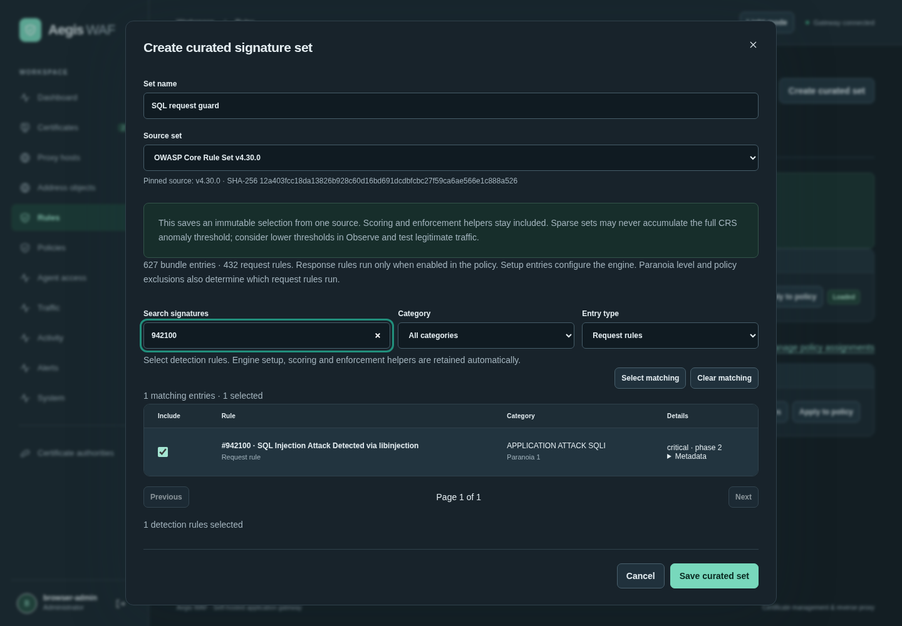
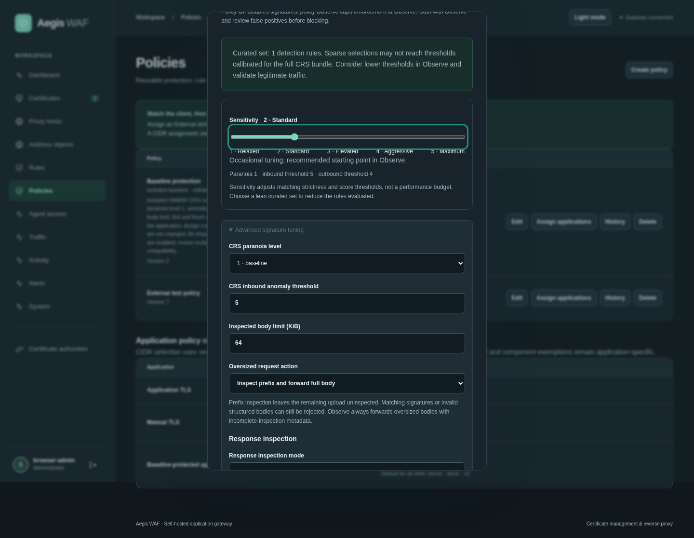

# Managed signature sets

Use **View signatures** on an available or loaded set to search and filter its individual IDs, descriptions, categories, severity and paranoia levels. Request rules are shown by default; setup and response entries are separately labeled, and response rules run only when response inspection is enabled in the policy. **Apply to policy** opens a new or existing policy with the set preselected, preserving existing groups and application assignments until an explicit save. In the policy editor, **Browse signatures and exclusions** selects individual rule exclusions; these update the existing excluded-ID field and take effect only when the policy is saved.

New installations and upgrades include the bundled set and an editable **Baseline protection** policy: Block, paranoia 1, anomaly threshold 5 and a 1 MiB request-body limit; bot/flood controls are off. It is not assigned to existing applications automatically. Select it in **Initial protection policy** when adding a proxy host or assign it from Policies. Provisioning happens once under the database initialization lock; restarts and future upgrades preserve administrator edits/deletion.

Use **Rules → Signature sets → Load signature set** to load a new bundled version into PostgreSQL. Then edit a policy in **Policies**, select the loaded version and choose Observe. Assign the policy to applications on the same page. Review matches before choosing Block. The policy editor can also load the bundle inline without discarding entered form values.

Loaded sets are immutable: a policy references a specific identifier, version and checksum. Image updates do not replace those stored bytes. New bundled versions must be explicitly loaded and selected. Custom JSON signatures and URL feeds remain available in rule groups alongside the managed set. No model output or URL feed can supply arbitrary Coraza/SecLang directives through this feature.

The implementation uses Coraza v3.8.1 and bundled CRS v4.30.0 for request headers, URI/query parameters and bounded request bodies. Optional response inspection is off by default. Web profiles check bounded eligible bodies before forwarding; SSE/streaming profiles use overlapping windows after delivery and may terminate the remaining stream. Protocol upgrades, binary gRPC and unsupported types have no body inspection. See [body inspection controls](body-inspection.md). Configuration and compiled WAF instances load with the background snapshot. Routing, certificate selection and signature matching make no per-request database or model calls.

Each policy chooses Off, Observe or Block, paranoia level 1–4, inbound anomaly threshold, request-body inspection limit (default 64 KiB, configurable 4 KiB–1 MiB), and up to 100 targeted known rule-ID exclusions. Global policy Off disables signatures; global Observe caps their mode to Observe. The default oversized-request action rejects in Block with 413. Administrators can instead select bounded prefix inspection and full forwarding; signatures and parser errors can still reject the request. Observe forwards oversized bodies and marks capped inspection; incomplete data is not a clean verdict. At most eight distinct managed configurations can be active, and inspection/buffer reservations are bounded per replica. Observe saturation is recorded and allowed; enforcing saturation fails with 503 rather than skipping inspection.

Logs record policy/version, set/version, effective request/response modes, separate inspection statuses and bounded request/response rule IDs. Matched values, request collections and Coraza audit/debug logs are not persisted by this integration. Optional evidence remains governed by its independent allowlist and redaction settings. Existing fact replay evaluates the custom DSL; it cannot faithfully replay all CRS transformations from incomplete/redacted samples.

The optional sealed recovery cache includes active signature bundles and compiled settings, so an explicitly cached replica can restore protection without PostgreSQL at startup. All serving replicas must run a build supporting managed signatures before policies enable them. Rolling back to an older build without this feature removes its enforcement; use a compatible rollback build or explicitly disable it first.

CRS broadens request and optional response-signature coverage; separate Aegis bot controls provide selective self-hosted CAPTCHA. Neither supplies verified-bot identity, behavioral learning or guaranteed attack/false-positive coverage. Application-specific tuning is still required. Stored corpus versions can be reused by later compatible builds, with replay/testing required when the Coraza implementation itself changes.

Authenticated `GET /api/signature-sets/{id}/rules` returns static corpus metadata for the current available bundle or a stored version. It does not load the bundle, publish a policy or return raw SecLang/matched request values. Inventory metadata is compiled on the management path and cached separately from active enforcement.

## Inventory and policy editor

Actual browser captures from the isolated acceptance fixture, with test-only configuration:

## Sensitivity and curated sets

New dashboard policies select the latest loaded original set in Observe, with Standard sensitivity. Existing policy values and the explicitly assigned baseline are preserved. Sensitivity is a form macro over existing paranoia, inbound threshold and outbound threshold fields; no slider value is stored. The advanced values update visibly, and edits that do not match a preset display **Custom**. Moving the slider replaces those three values only. Mode, response-inspection enablement, exclusions and body limits remain independent.

| Sensitivity  | Paranoia | Inbound | Outbound | Expected tuning                                          |
| ------------ | -------- | ------- | -------- | -------------------------------------------------------- |
| 1 Relaxed    | 1        | 10      | 10       | Fewer blocks; subtle attacks may not reach the threshold |
| 2 Standard   | 1        | 5       | 4        | Occasional tuning; recommended Observe starting point    |
| 3 Elevated   | 2        | 5       | 4        | More sensitive patterns; review false positives          |
| 4 Aggressive | 3        | 3       | 3        | High false-positive risk                                 |
| 5 Maximum    | 4        | 2       | 2        | Expect legitimate traffic blocked without careful tuning |

The slider is not a throughput or latency control. Paranoia uses runtime gating and does not shrink the compiled corpus; actual work depends on traffic and enabled rules. No equal-throughput claim is made across levels.

Use **Rules → Signature sets → Create curated set** to select detection rules from one installed original set. Search/filter and **Select matching** / **Clear matching** apply to the current filters across pages; individual choices persist across searches. Engine initialization, non-detection helpers, anomaly scoring and enforcement rules are retained automatically. Request and optional response detections can be selected independently. A sparse selection may never accumulate thresholds calibrated to the full CRS bundle: start in Observe, consider lower thresholds, and test both attacks and legitimate traffic.

Saving creates an immutable artifact with source set ID, version, SHA-256 and sorted selected IDs. It copies the frozen source files, retains their notices, and appends generated `SecRuleRemoveById` overlays for unselected detectors. The existing Coraza compile path is unchanged. This reduces the detection rules evaluated per transaction, without promising a particular latency gain or reducing the stored source footprint. The legacy `rule_count` describes IDs in the stored source files; `curation.selected_rule_ids` and the filtered inventory describe the chosen detection subset. Setup/support rules remain in that inventory.

Curated sets appear alongside original sets in policy selection. Applying a different set preserves the policy's sensitivity, limits, response settings and exclusions, and opens the changed selection in signature Observe; any incompatible exclusion IDs must be reviewed before saving. Each policy still references one immutable set. Creating another set or loading a source version does not replace published policy references. Publishing a changed policy remains an explicit authenticated save, with the existing simulation requirement for MCP callers. Curation uses the existing administrator/CSRF-protected set-creation endpoint and MCP `enforce` scope; it does not activate protection by itself.

**Review upstream** compares the pinned source with the current bundled CRS source. Selected IDs in changed rule files or affected by changed retained helpers/shared data are flagged conservatively; this is not a semantic proof that every flagged rule changed. Removed IDs are identified. Reviewing opens a builder for a new artifact, retaining surviving selections and leaving new upstream detections unselected. Review, save, then explicitly select that new artifact in affected policies. Older bundled versions do not prompt a downgrade. Currently the source catalogue is the bundled versioned CRS corpus; arbitrary remote SecLang feeds, cross-source merging and nested curated sources are unsupported.

Schema 21 adds nullable curation metadata. At most 64 curated artifacts are stored; the existing eight-active-managed-configurations-per-replica budget remains. All serving replicas must support curated artifacts and their overlays before using them. Older binaries must not be used to edit or enforce these sets; use a compatible rollback image and retain the database/external-key backup.

### Screenshots and measurements

These screenshots were captured from the tested policy UX build in the isolated browser/Pebble fixture, using synthetic policy names and test traffic. They do not show production configuration.

The [before/after benchmark record](benchmarks/policy-ux-20261026.md) includes native rule evaluation at 100/1000 rules, identity/protection, forwarding, and a separate full-source versus single-detector managed-inspection example. The examples differ in protection coverage and do not establish production latency or capacity.
