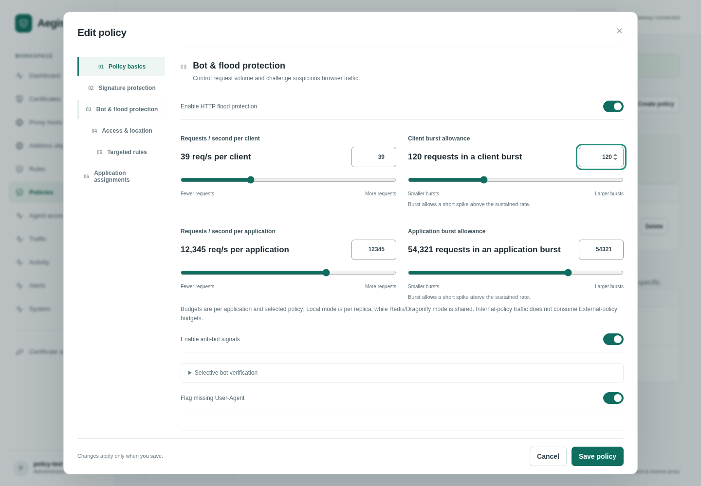

# Protection policies

Use **Policies** to create reusable protection and assign it to one or more applications. Each policy has Off, Observe or Block mode, independent bot/flood switches, configurable per-client and per-application flood budgets, and up to ten named rule groups. A group's optional path prefix and method list narrow all its signatures. The signature's own conditions and path prefix also apply.

**Rules** is one workspace with Signatures, Rule feeds and Signature sets tabs. [Managed signature sets](managed-signatures.md) can be selected directly in a policy. Create or import signature drafts there, then select them in policy groups. A published policy stores frozen copies: editing a signature or syncing a feed never silently changes live policy enforcement. Check **Refresh selected rule snapshots from the library** and save to publish changes. Policy History restores protection and signature snapshots for current application assignments; it does not restore historical assignments. Revisions reject stale saves. Policies remain configured until explicitly changed or removed; standalone rule activation keeps its existing TTL behavior.

## Creating and editing a policy

Click the **?** beside a technical setting for a short explanation. **Read detailed explanation** opens the built-in glossary in a new tab and keeps this form open; [the same glossary](glossary.md) is available in the repository docs.

The editor has six sections, with navigation on the left on desktop and a scrollable section bar on smaller screens:

| Section | What to configure |
| --- | --- |
| Policy basics | Name, description and Off / Observe / Block mode cards |
| Signature protection | Managed set, sensitivity, body/response inspection and rule exceptions |
| Bot & flood protection | Feature switches, client/application budgets and selective CAPTCHA settings |
| Access & location | Searchable address objects/groups, CIDR lists, allow behavior and countries |
| Targeted rules | Community mitigations and application-specific native groups |
| Application assignments | Default or client-scoped assignments and matching priority |

The preview explains the overall mode, including when Observe caps signature enforcement. Changes apply only after **Save policy** succeeds. A failed save keeps the editor and entered settings available for correction or retry.

Use the sliders for rates, burst allowances, suspicion scores, clearance duration, inspection limits and assignment priority. The adjacent exact-value field remains available for precise settings. Rate/burst scales are logarithmic to make both small and large budgets practical; other scales use ordinary numeric steps. Burst must be at least the sustained rate. Turning flood protection off preserves its configured limits. Opening a policy never rounds its values to the nearest slider position; custom sensitivity and exact byte limits remain intact until deliberately changed.

In **Access & location**, select objects/groups with searchable checkboxes and countries by name or two-letter code. Selected countries appear as removable chips; **Enter country codes directly** remains available. CIDR allow behavior explicitly chooses Geo-only bypass or all WAF protections. Blocking and allow-list order is unchanged.

Under **Signature protection → Signature exceptions**, use **Add scoped exception** and **Choose rules**, then narrow the exception by request path, parameter names and/or verified client ranges. Conditions combine as described in [Security tuning](security-tuning.md#false-positive-tuning). The advanced JSON editor remains available for API-oriented workflows. Global rule exclusions remain separate. For native groups, method chips cover common HTTP methods and **Other methods / exact list** preserves custom methods such as PROPFIND.

## Sensitivity and reusable managed sets

New dashboard policies start in Observe with the latest loaded original signature set and **2 · Standard** sensitivity. The 1–5 control updates paranoia plus inbound/outbound thresholds; Standard is PL1/5/4. Editing those fields under **Advanced signature tuning** or **Body and response inspection** shows Custom when no preset matches. The slider leaves modes, inspection limits, exclusions and response inspection enablement alone. Aggressive and Maximum need careful false-positive tuning.

For a tailored detection subset, open **Rules → Signature sets → Create curated set**, select detections from one installed original CRS source and save. Required setup/scoring/enforcement helpers stay included. Choose the saved artifact from the policy's Signature set dropdown. **Apply to policy** preserves its existing settings and opens a different set in signature Observe; save explicitly after review. Each policy still references one managed set. Community mitigations and native groups remain separate controls.

Curated source/version/digest and selections are immutable. **Review upstream** identifies selected rules needing conservative file/shared-helper review, then opens a builder for a replacement artifact. Saving it does not replace published policy references. Sparse selections may not reach full-bundle anomaly thresholds; test legitimate and attack requests in Observe before enforcement. [Preset table, builder and review limits](managed-signatures.md#sensitivity-and-curated-sets).

## Included baseline

**Baseline protection** ships with request-side CRS enabled in Block mode, paranoia level 1, anomaly threshold 5 and a 1 MiB body limit. All shipped community mitigations are enabled; the multipart/Brotli guards reject those declared request types, including legitimate uploads. Bot and flood controls are off because their appropriate budgets vary by application. Requests above the body limit receive 413 when this policy enforces; tune upload-heavy applications before assignment.

Choose this policy under **Initial protection policy** when creating a proxy host, or assign it from this page. Site creation and initial policy assignment commit atomically; a failed assignment creates neither. Omitting that choice preserves local application settings. Existing applications are never reassigned automatically. The baseline can be edited, renamed or deleted, and provisioning will not recreate or overwrite it on restart. Up to 50 custom policies are supported in addition to the included baseline.

## External and internal traffic

Assign an External policy with **All other clients · default** first. Then assign an Internal or office policy to specific IPs/CIDRs with a priority of 0–9999. Smaller priorities match first. Every application using scoped policies must retain one default; choosing a new default replaces its old assignment atomically. Overlapping CIDRs use priority rather than longest-prefix matching. At most ten policies can be assigned to an application.

Client identity is resolved using the application's trusted proxy settings. A direct visitor cannot select an internal policy by forging forwarding headers. Missing or invalid identity from a trusted proxy is eligible only for the default policy. Selecting a trusted policy does not automatically allow traffic: its configured groups, mode and bot/flood protection determine the action.

Assigned policies replace local bot/flood and standalone rule activation for that application. Applications without assignments keep existing local behavior. Headers, trusted proxies and component CIDR exemptions remain application settings. Flood budgets are per application and selected policy; trusted-policy traffic does not consume an external policy's budget. Local mode is per replica; optional Redis/Dragonfly mode coordinates counters across replicas. See [shared rate state](shared-rate-state.md).

Configuration and frozen signatures live in PostgreSQL and propagate through the normal two-second snapshot refresh. Requests select cached policies without database or model calls. Metadata logs identify the selected policy and version. Policy saves, default reassignment, deletion and rollback produce administrative audit events.

Native rules use deterministic matching and blocking; managed CRS uses its own anomaly scoring. Native weighted scoring, endpoint-specific rate budgets and built-in AI policy generation are not implemented. External agents can propose and apply scoped, simulated changes through MCP.

## Configure the recent controls

- **Geo:** Edit the policy and expand **CIDR access and Geo blocking**. Set Geo mode, country-list behavior, country codes and unknown-location behavior. The Country database must be downloaded first. [Step-by-step Geo setup](geolocation.md#apply-geo-blocking-to-an-application).
- **Selective CAPTCHA:** enable anti-bot signals and **Challenge suspected bots with self-hosted CAPTCHA**. Tune the threshold, frequency and clearance window; Observe never challenges. API/SSE hosts block high suspicion with JSON instead of a browser challenge. Clearance does not bypass other protections. [Bot verification](bot-protection.md).
- **Response inspection:** use **Signature protection → Body and response inspection**. Response mode defaults Off. Web profiles buffer eligible bodies; SSE/streaming profiles inspect after delivery. Endpoint type/window belong to the proxy host. [Inspection controls](body-inspection.md).
- **Shared budgets:** select the deployment-wide backend under **System → Rate-limit state**; policy rates still set the budgets. Local is per replica; optional Redis/Dragonfly is shared. [Backend setup](shared-rate-state.md).

MCP agents must simulate the exact protection mutation and provide a fresh `simulation_id`; dashboard administrators continue using session/CSRF authorization. Rules, CIDR lists and TLS configuration compile into a new snapshot before an atomic swap. Open requests keep their admitted configuration; new requests use the refreshed one. [Agent safety gate](agent-access.md#required-simulation-before-live-protection-changes) · [Reload behavior](architecture.md#atomic-reload-and-active-connections).

## Community mitigations

Edit a policy and use **Community mitigations** to enable or disable catalogue rules independently of native groups and CRS. Select **All available mitigations** or individual rules; search by CVE/name and inspect coverage/compatibility. Disabling preserves the selection for later re-enabling. Custom policies default off. The shipped baseline enables all bundled community mitigations before its first network sync; its one-time upgrade preserves other settings and assignments. Multipart and Brotli upload guards can reject legitimate traffic: review compatibility before assigning the baseline.

Published definitions retain feed revision/checksum/CVEs. An ordinary save preserves them; **Refresh selected mitigation snapshots** adopts downloaded revisions on save. Selecting all captures the current list, not future additions automatically. Existing catalogue rules in custom groups retain their group path/method scopes and also obey the community enable/selection controls. Native noncatalogue groups remain independent. **Rule feeds** manages subscriptions and read-only review. [Full workflow](rule-feeds.md).
