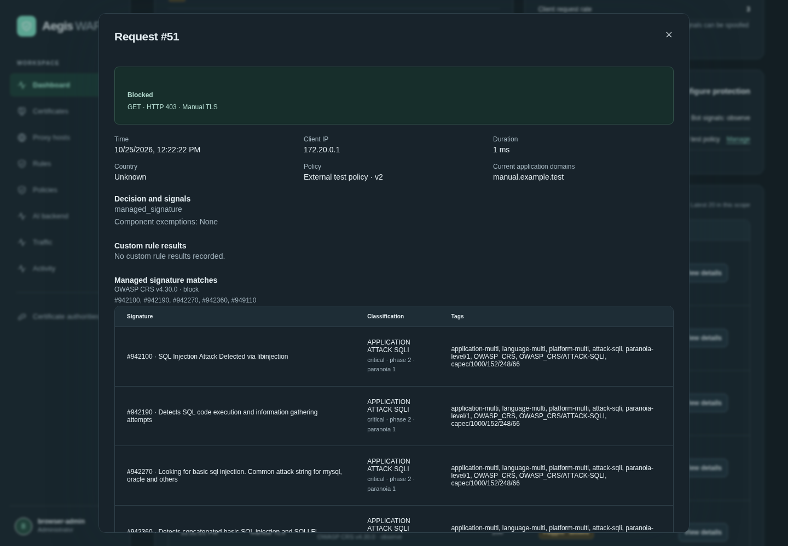

# Investigate a request

You can also start in **Applications → Open → Recent traffic**, where requests are already scoped to the selected application. From a request, **Review current policy** opens the latest policy. **Draft exception** beside an eligible managed detection rule seeds an unsaved exception; choose its scope and review shared application assignments before saving. The editor uses the current policy, while request details retain the recorded revision. [Application workflow](applications.md).

Every listed request has **View details**, including Allowed, Flagged · allowed and Blocked outcomes. Open it from **Dashboard → Recent requests** or **Activity → Application requests**. The Dashboard lists the latest 20 requests in its selected scope; Activity lists the latest 200. The authenticated management API can fetch a retained log by ID with `GET /api/access-logs/{id}`.

The detail view shows timestamp, resolved client IP, method, application, response status, duration, country, selected policy/version, recorded signals, component exemptions and custom/managed signature results. An upstream HTTP error is distinct from a WAF block: the stored block decision determines the outcome label.

For custom rules in a policy, names and definitions come from that request's recorded policy revision. Later library edits do not replace that explanation. If the historical revision is unavailable, any current library definition is explicitly labeled as current and may differ from the original. Standalone logs do not retain a complete historical rule definition, so the same qualification applies. Missing definitions remain unavailable rather than being guessed.

Managed signature descriptions, categories, severity and paranoia levels come from the recorded set identifier. New logs report named detection/scoring matches rather than CRS control-flow entries. Older logs can contain housekeeping matches; the detail view separates those from attack detections. Logs retain the matched rule IDs even if the corresponding bundle's metadata is unavailable. Incomplete inspection and early decisions are shown; a missing match is not a guarantee that all protections ran.

## Retained request content

Opening details does not enable additional capture or replay a request upstream. Default access metadata does not include full URLs, query values, headers or bodies. Application domains shown in the summary are the current configuration, not proof of which Host header the historical request used.

When an opt-in sampled evidence record is still available, the view shows its retained field values and capture states: present, missing, redacted, truncated or unavailable. These are the allowed selected facts, not a complete raw request. Configure capture under **Traffic** before collecting the fields you need. Never enable unrestricted credential/header/body collection to make an investigation view appear complete.

Uncaptured data cannot be reconstructed. Expired evidence is excluded by the detail API even if physical deletion has not run yet. Removed or expired samples are labeled accordingly. Access/audit logs have separate manual retention. See [evidence privacy](evidence-privacy.md), [capture limits](rules.md#capture-and-privacy) and [logging behavior](logging.md).

All detail APIs require an administrator session. Values and definitions are rendered as escaped text, and stored private keys/provider credentials are not part of these records.

