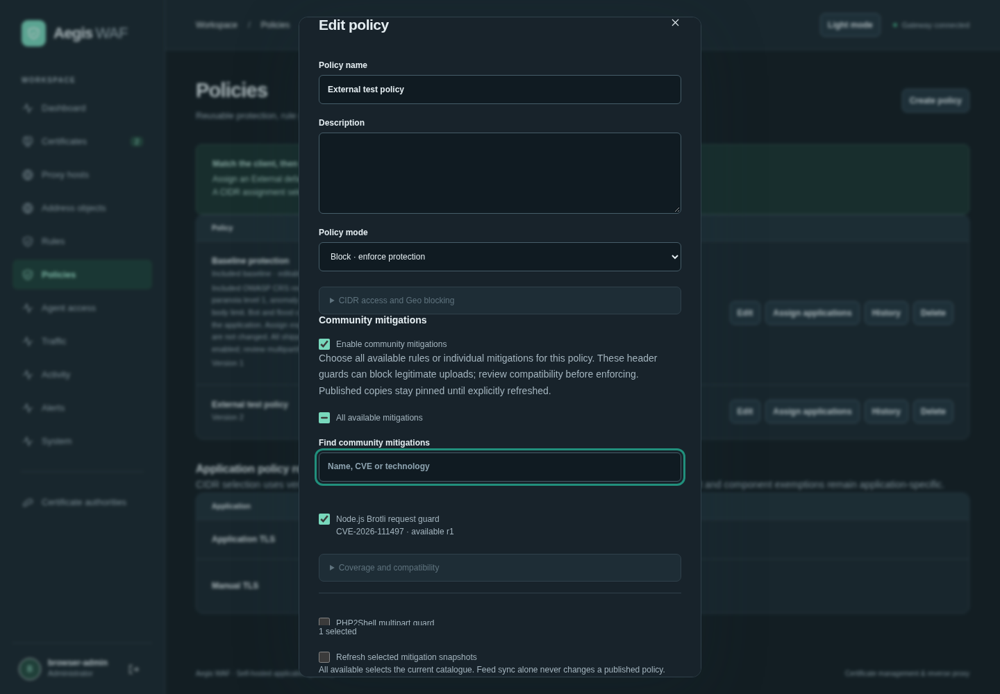

# Rule catalogues and source subscriptions

Workspace catalogues share independently versioned rules across policies. A small manifest lists **one file per rule**, with a revision and SHA-256 checksum. Administrators choose individual rules or packs; downloading updates never changes published protection automatically.

## Enable mitigations in a policy

1. Open **Policies → Edit → Community mitigations**.
2. Turn on **Enable community mitigations**, then check **All available mitigations** or select individual rules. Search by CVE or name and expand coverage/compatibility notes before enforcing.
3. Save the policy. Turning the switch off preserves its selection but disables all catalogue mitigations for that policy; turning it back on restores the selection. Policy Off/Observe/Block still governs enforcement.
4. To adopt downloaded revisions, check **Refresh selected mitigation snapshots** and save. An ordinary save preserves frozen definitions. Selecting all captures the currently available rules; later feed additions do not silently enable themselves.

The shipped **Baseline protection** policy enables every shipped community mitigation, alongside CRS. The reviewed initial rules are bundled into the application, so this does not depend on a successful first network sync. On upgrade, the baseline receives this field once if absent; its other settings and assignments are preserved. Subsequent administrator selections or disabling are never overwritten on restart. Custom policies start with community mitigations off.

**Review upload compatibility before assigning the baseline:** it blocks declared multipart forms/uploads and Brotli-encoded requests. Disable incompatible rules or use a custom policy for applications that need these request types.

**Rules → Rule feeds** manages subscription URLs, sync and read-only catalogue review. It does not apply rules to policies. The Aegis community subscription is provisioned once; deletion persists, and **Use Aegis community feed** can add it again. Removing the source retains published copies, including the baseline's copies.

The current feed includes two **partial delivery-path mitigations**:

| Rule / pack | Advisory | What it matches | Compatibility cost |
| --- | --- | --- | --- |
| Node.js Brotli request guard | CVE-2026-111497 | Requests declaring `Content-Encoding: br`, including encoding lists | Blocks legitimate Brotli-compressed uploads; `Accept-Encoding: br` response negotiation is unaffected |
| PHP multipart request guard | CVE-2026-109618, CVE-2026-109619 | Requests declaring `Content-Type: multipart/form-data` | Blocks legitimate multipart forms and uploads |

These are header guards, **not exploit detectors or substitutes for patched runtimes**. They do not cover direct-origin access, unlabelled payloads or application-specific decoding. The Node guard does not cover outbound downloads, including PHP Windows cURL's Brotli path. The PHP guard does not cover every triggering path or existing corrupted worker state. Review each rule's metadata and linked upstream advisories before applying it.

Public subscription URL:

```text
https://api.github.com/repos/nextgridit-team/Aegis-WAF/contents/rules/community/manifest.json
```



## Sync and policy updates

The first scheduled check runs within 30 seconds, then every 12 hours. **Sync now** checks immediately. PostgreSQL coordinates checks across replicas; no extra worker container is required. The page shows errors, last success and next check. Failed downloads, checksum failures, invalid rules, failed regression vectors and revision conflicts preserve the complete last successful catalogue. Checks use ETags when available.

Policies store frozen rule definitions and feed provenance: source, entry ID, revision, checksum, pack and CVEs. An ordinary policy edit preserves these copies. Review shows **Update available** beside policies using an older definition. In the policy editor, use **Refresh selected mitigation snapshots** to refresh the current community selection. **Refresh selected rule snapshots from the library** refreshes all selected library snapshots on save. Existing history/rollback retains its frozen definitions. Removed feed entries disappear from the available picker; existing policy copies keep working. Removing a source also retains published policy copies and legacy imported rules, but prevents refreshing them from that source.

A changed catalogue increments the configuration version to invalidate stale MCP simulation receipts; it does not replace live policy copies. Policy changes propagate through the usual two-second snapshot refresh. MCP agents must simulate the exact policy mutation before publishing it.

## Publish your own per-rule feed

Choose **Add source**, a name and public HTTPS URL, and **Workspace catalogue · all policies (manifest v2)**. Host the manifest and rule files in the same directory. See the [community authoring guide](../rules/community/README.md) for a complete rule file and reproducible tooling.

```json
{
  "schema_version": 2,
  "name": "Example application guards",
  "revision": 1,
  "rules": [
    {
      "id": "my-rule",
      "path": "my-rule.json",
      "sha256": "<64 lowercase hexadecimal characters: SHA-256 of the exact file bytes>"
    }
  ]
}
```

Every rule file contains `schema_version: 1`, stable `id`, increasing `revision`, `pack`, `technology`, `cves`, `description`, `affected_versions`, `coverage`, `limitations`, `false_positive_risk`, public HTTPS `references`, a native declarative `rule`, and `tests`. Tests include at least one matching and one nonmatching case, with bounded method/path/headers/body and `expected_match`. All cases must pass before a sync commits. The download normalizes action to Observe, clears external evidence IDs and replaces the placeholder application scope when compiling into assigned policies. Policy mode determines enforcement.

Increment a rule's revision whenever its bytes change; regenerate the manifest checksums and increase its revision too. Lower revisions and changed bytes reusing an existing revision are rejected. IDs use 1–64 letters, digits, dots, underscores or hyphens. Paths must be relative JSON paths beneath the manifest directory, without traversal or query parameters. Unknown fields and malformed documents are rejected. Limits: 20 sources, 100 rules/manifest, 1 MiB manifest, 64 KiB/rule file, 8 MiB total download, 2000 stored catalogue entries, 2–16 regression cases/rule, 30-second overall download and 20-second individual requests. Removed entries still consume catalogue capacity until their source is removed.

Checksums verify file bytes against the downloaded manifest. **They are not publisher signatures**: trust the publisher and HTTPS source. This format carries bounded declarative signatures, never executable plugins or remote scripts. ModSecurity/CRS, Suricata, YARA and arbitrary vendor feeds need an explicit converter.

## Legacy application feeds

Existing application-bound version 1 subscriptions continue working. Choose an application labelled **legacy v1** to use a single JSON document such as [rules/starter.json](../rules/starter.json). Review and **Import pending as drafts** creates disabled, application-scoped local rules with proposed Observe action. Changed candidates import as new drafts; unchanged imports create no duplicate. Older imported rules are not automatically replaced or disabled. These subscriptions do not populate the workspace catalogue.

## URL and network constraints

Public HTTPS on port 443 only. Credentials, query parameters, fragments and redirects are rejected. The downloader validates DNS results for every new connection and connects to the validated IP while retaining hostname TLS verification. Environment proxies cannot bypass these checks. Private-network and authenticated feeds are unsupported. GitHub Contents API URLs use GitHub's raw-content media type; public API rate limits still apply.

## API and permissions

- `GET /api/rule-feeds`, `POST /api/rule-feeds` (`name`, `url`, optional `site_id`; omit or use `0` for workspace, positive ID for legacy)
- `GET /api/rule-catalog`: available workspace rules and stable IDs for policy group selection
- `GET /api/rule-feeds/{id}/items`: definitions, metadata, availability and pinned-policy/update information
- `POST /api/rule-feeds/{id}/sync`, `DELETE /api/rule-feeds/{id}`
- `POST /api/rule-feeds/{id}/import`: legacy sources only
- Policy writes accept `spec.community_mitigations: {"enabled": true, "rule_ids": [catalogue_rule_id]}`. `refresh_rule_ids` targets snapshot updates; send the current policy revision and complete specification/assignments.

Administrator authentication and write CSRF checks apply. Source creation, successful sync, import and removal are audited without recording rule contents or credentials. MCP exposes the catalogue through the existing scoped management interface; it cannot bypass the required policy simulation gate. See [management API](management-api.md) and [agent access](agent-access.md).
