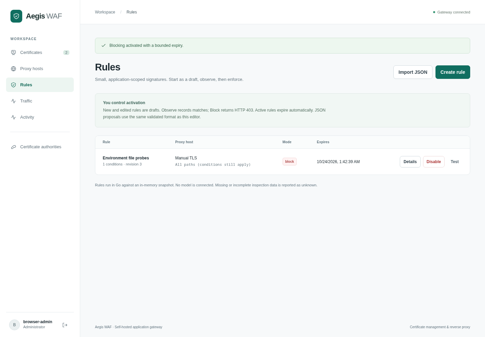

# Declarative rules and traffic evidence

Aegis evaluates administrator-authored JSON signatures in Go. The native engine does not run a model, learn behavior or activate proposals automatically. Named [rule feeds](rule-feeds.md) provide synced candidates; [bot verification](bot-protection.md) and [flood controls](shared-rate-state.md) are configured separately. External agents can use the [MCP interface](agent-access.md) to propose structured rules, test them and make authorized changes with simulation receipts. Imported proposals remain disabled drafts. Treat captured traffic and model output as untrusted input.

## Workflow

1. Create a proxy host and verify its certificate and upstream.
2. In **Traffic**, optionally configure sampling for that application. Capture is disabled by default. Select only the fields you need.
3. In **Rules**, create a rule with the editor or import JSON. Every condition must match. New and edited rules are drafts, including edits to an active rule.
4. **Test** evaluates selected stored evidence locally. No requests are sent to an upstream. Inspect the matched, not-matched, and unknown counts.
5. **Observe** records matching rule IDs while continuing normal proxying. **Enforce blocking** requires an explicit administrator action and returns HTTP 403 for matches. Activation lasts between 60 seconds and 24 hours. Disable or rollback when needed.

Rollback restores the immediately preceding saved state, including its original expiry. It cannot extend an expired activation. Successive rollbacks toggle between the two most recent states. Saving, activation, disabling, deletion, rollback, and capture configuration are authenticated, CSRF-protected, transactionally audited operations. Audit entries contain action/resource IDs, not condition values or samples. History persists in PostgreSQL; the UI shows the latest 20 entries.

MCP live-protection mutations require `simulate_rule_impact` and a fresh `simulation_id` in addition to the key scope. The dashboard workflow uses administrator sessions/CSRF instead. For policy-bound applications, add a draft to the intended frozen policy group; standalone activation does not replace that policy. [Policy workflow](policies.md) · [Simulation contract](agent-access.md#required-simulation-before-live-protection-changes).

## Version 1 format

```json
{
  "schema_version": 1,
  "name": "Environment file probes",
  "scope": { "site_id": 1, "path_prefix": "/" },
  "all": [
    { "field": "method", "op": "in", "value": ["GET", "HEAD"] },
    { "field": "path", "op": "equals", "value": "/.env" }
  ],
  "action": "observe",
  "ttl_seconds": 3600,
  "evidence_ids": []
}
```

Use an actual existing site ID. `path_prefix` and `evidence_ids` are optional; evidence references must identify unexpired samples from that site at save time. The authenticated `GET /api/rules/schema` endpoint serves the JSON Schema. Unknown JSON properties are rejected. Runtime validation additionally checks site existence, protected fields, RE2 syntax, CIDRs and byte limits. Invalid edits preserve the previous working version.

| Field       | Key                                           | Operators / meaning                                                                   |
| ----------- | --------------------------------------------- | ------------------------------------------------------------------------------------- |
| `method`    | None                                          | `equals`, `in`; uppercase letters, e.g. `GET`                                         |
| `path`      | None                                          | `equals`, `in`, `contains`, `prefix`, `regex`; Go URL path, decoded once              |
| `client_ip` | None                                          | `cidr`; resolved client IP, IPv4 or IPv6 (peer unless trusted proxies are configured) |
| `header`    | Header name                                   | `equals`, `in`, `contains`, `prefix`, `regex`; case-insensitive header names          |
| `query`     | Query key                                     | Same string operators; query decoding once, including `+` as space                    |
| `json_body` | JSON pointer, e.g. `/file` or `/items/0/name` | Same string operators; scalar string, number or boolean                               |

String values compare case-sensitively. `in` takes an array of 1–32 strings; other operators take one string. Repeated query/header values use any-value matching. Conditions combine with AND; there is no arbitrary code, scripting, shell, SQL, recursive expression language, or external call. Regex uses Go's linear-time RE2 engine without lookaround/backreferences. The optional path prefix is a literal string prefix, not a path-segment boundary. Paths are not case-folded, dot-segment cleaned, or repeatedly decoded by the engine. Upstream frameworks can interpret paths, headers and query strings differently; these rules are deliberately not a complete injection detector.

`client_ip` uses the resolved client identity: transport peer by default, or the selected client-IP header from an explicitly trusted proxy. See [identity and CIDR controls](headers-and-cidrs.md). Bot/flood CIDR exemptions do not bypass declarative rules.

## Limits and incomplete inspection

There are at most 100 saved rules per site, 1,000 total, 12 conditions per rule, 512 UTF-8 bytes per condition string, 32 `in` choices, and 32 regex capture groups. Named query/header keys are restricted to 64 ASCII letters, digits, dots, hyphens or underscores. JSON pointers support at most eight levels and 128 bytes.

Facts over 4,096 bytes or 32 repeated values are unknown. JSON inspection accepts JSON media types, reads at most 64 KiB plus one overflow byte, limits nesting to 16 levels and parsing to about 512 value tokens, and rejects duplicate object keys and trailing data. Larger bodies, unsupported types, malformed JSON/query encoding, or exhausted inspection budgets produce unknown. Original request bytes remain available to the upstream; a body is only inspected when a rule or permitted capture needs it.

A missing selected field is a non-match. An uncaptured, redacted, truncated, unsupported or invalid fact is unknown. For AND, a definite false condition makes the rule a non-match even if another condition is unknown. Unknown alone never blocks. This means rules can miss requests whose relevant data cannot be inspected; unknown is not proof that traffic is benign. Replay evaluates the proposed rule against stored facts, independent of whether the rule is active, and cannot reconstruct discarded data or prove a false-positive rate for all traffic.

## Capture and privacy

Capture is per site, off by default, sampled, and capped per replica. Settings select at most four query keys, four header names and four JSON pointers. Paths require a separate opt-in. Every sample also includes method, direct peer IP, content type without parameters, declared body length, and rule outcomes. Full URLs, entire bodies, response bodies, authorization and cookies are not captured. Known sensitive field names and referrer/forwarding headers cannot be selected for either rules or capture.

Samples retain at most two values per selected field, at most 192 UTF-8 bytes per value, and 16 KiB total. Common credential formats and common path identifiers are redacted before persistence. Redacted or truncated previews are never used as complete facts during replay. Redaction is best effort: personal data or custom secrets in an allowed field or path can remain. Review allowlists and application URL conventions before enabling capture. Samples are visible to authenticated administrators and are stored as JSON in PostgreSQL; use appropriate database/backups/access controls. Sample values are rendered as escaped text, not HTML.

Sampling supports one in 1–10,000 requests, at most 1–600 samples per minute per replica, and a per-application capture expiry of 1–168 hours. The budget survives configuration refresh but resets on replica restart. Adding replicas increases aggregate capture capacity. Existing samples keep their original capture expiry; the current global retention window can shorten their visibility further. Disabling capture stops new samples without deleting existing ones. APIs/replay hide expired samples immediately, while coordinated bounded cleanup removes them when PostgreSQL is available. **System → Logs & retention** controls the global access/audit/evidence window, six hours by default. [Delivery and retention behavior](logging.md).

Evidence and metadata use the existing non-blocking 8,192-event memory queue and batched database writer. Each metadata record includes rule outcomes and an optional evidence ID. Queue saturation, process crashes and database outages can lose samples/logs; `/api/status` exposes this replica's dropped-event counter. Logging failure does not stop proxying. Sampling is not a lossless forensic archive.

## Persistence and propagation

The additive schema migration creates rules, rule revisions, traffic settings and evidence tables, and extends access logs without deleting existing certificate/site/account records. Migration runs under the existing PostgreSQL schema lock. Configuration writes increment the shared version. Each replica atomically refreshes its rules, routes, certificates and capture settings within the documented two-second polling interval. Normal rule evaluation and capture decisions use the in-memory snapshot without a routing-time database query.

On a database outage, existing replicas retain their cached rules and proxy configuration. Activation expiry is checked on every request, so an expired rule stops enforcing even when the database cannot be refreshed. Disable/edit/rollback require a successful database write and propagation. Administration returns failure when the store is unavailable; new replicas remain unready without an initial complete snapshot. Keep replica clocks synchronized for expiry accuracy.

## Management API

All routes below require the existing administrator session. Mutations require JSON and the same-origin/CSRF headers documented in the [management API guide](management-api.md).

| Endpoint                              | Behavior                                                           |
| ------------------------------------- | ------------------------------------------------------------------ |
| `GET /api/rules`                      | List rules, revisions, status and expiry                           |
| `POST /api/rules`                     | Save a validated `RuleSpec` as a draft                             |
| `PUT /api/rules/{id}`                 | Save the complete replacement spec as a draft                      |
| `POST /api/rules/{id}/activate`       | `{ "action": "observe", "ttl_seconds": 3600 }` or `block`          |
| `POST /api/rules/{id}/disable`        | `{}`; disable while preserving history                             |
| `POST /api/rules/{id}/rollback`       | `{}`; restore the preceding state and original expiry              |
| `DELETE /api/rules/{id}`              | Delete rule and its revision history                               |
| `GET /api/rules/{id}/history`         | Latest 20 previous states                                          |
| `GET /api/rules/schema`               | Version 1 JSON Schema                                              |
| `GET /api/traffic-settings`           | Saved per-site sampling settings                                   |
| `PUT /api/traffic-settings/{site_id}` | Complete replacement sampling configuration                        |
| `GET /api/traffic-events?site_id=1`   | Latest 100 unexpired events, optionally scoped                     |
| `POST /api/rules/replay`              | `{ "rule": <RuleSpec>, "event_ids": ["..."] }`; at most 200 events |

Replay rejects missing, expired or foreign-site event IDs rather than silently omitting them. It returns per-event outcomes, aggregate counts, and `live_requests_sent: 0`.


